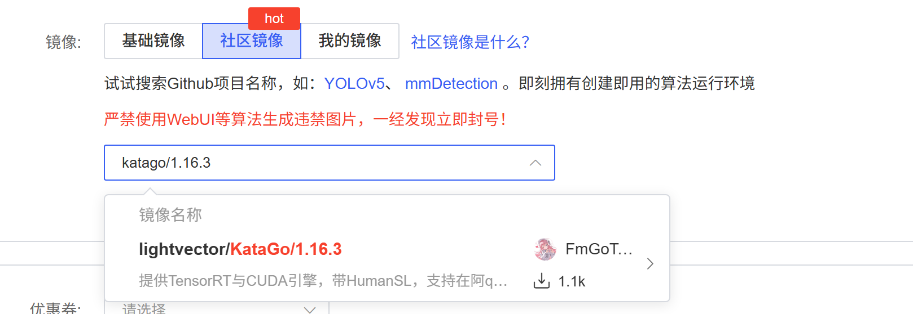
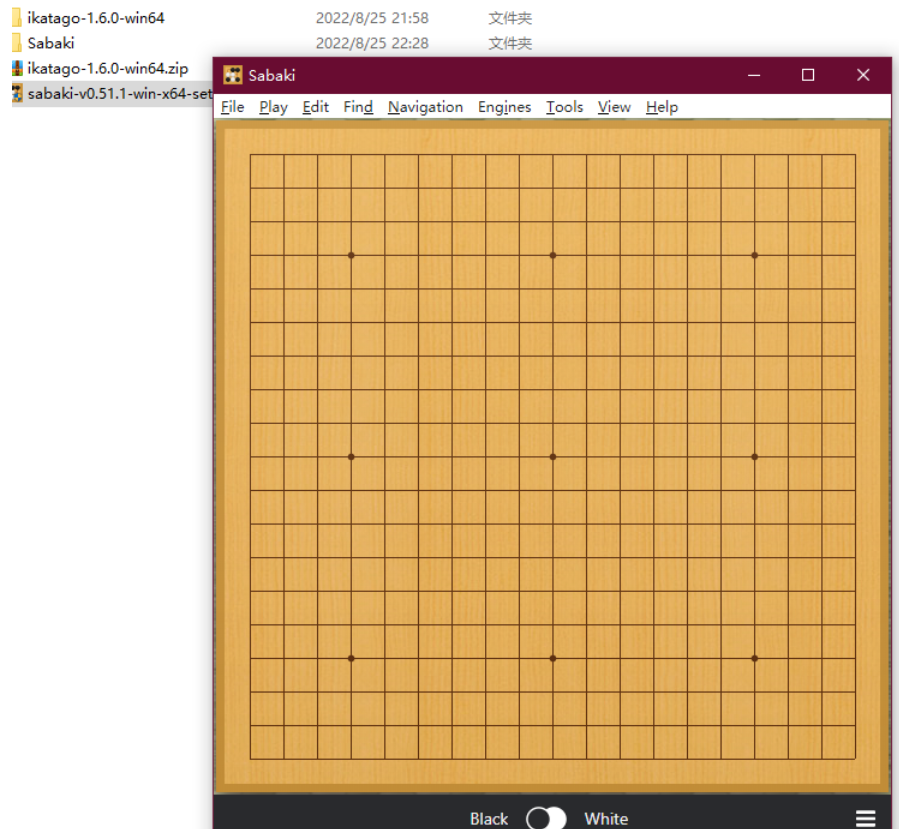
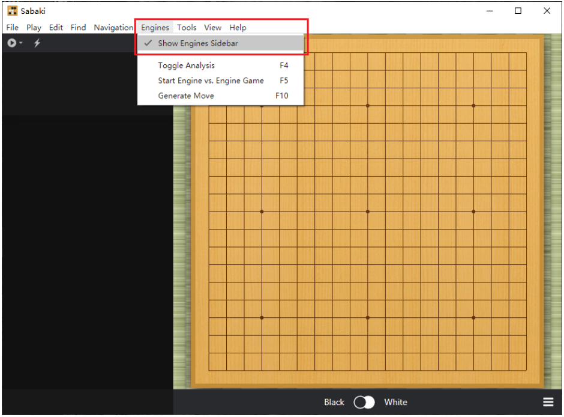
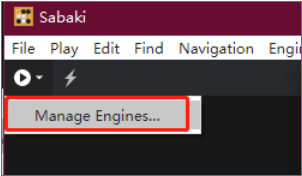
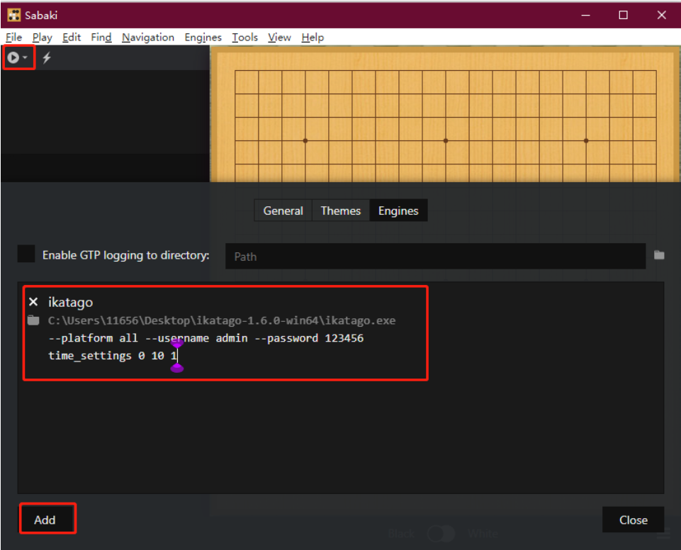
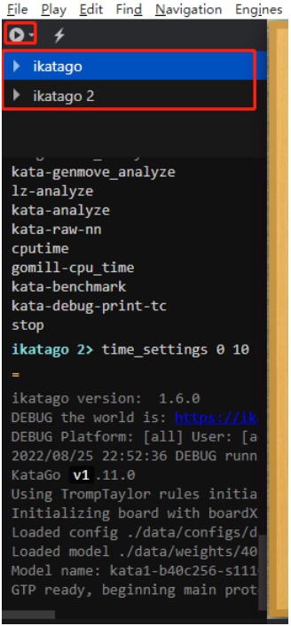
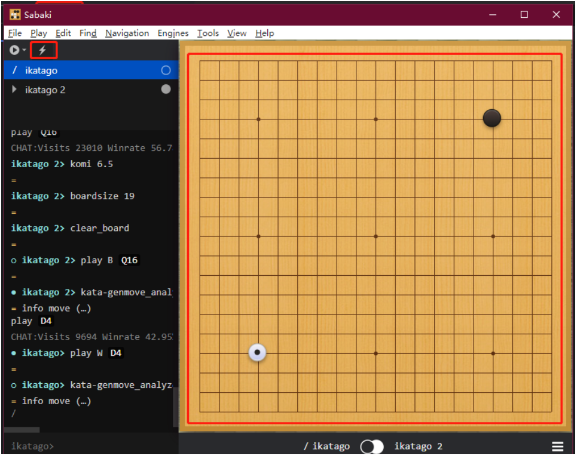

ikatago服务端地址：[ikatago-server项目地址](https://github.com/kinfkong/ikatago-server)

ikatago客户端：[ikatago-client项目地址](https://github.com/kinfkong/ikatago-client)

## 创建实例

使用环境为:  GPU=3090 * 1   CUDA=11.3

此外您在创建时可以直接使用CodeWithGPU社区中其他用户创建的Katago镜像

<Frame>
  
</Frame>

创建实例过程略

## 安装ikatago-server

下载并安装

```
wget https://ikatago-resources.oss-cn-beijing.aliyuncs.com/all/install.sh  #获取安装脚本
bash install.sh
```

启动ikatago服务

```
# katago会安装在当前目录下的work文件夹下
cd work  
# 启动服务./run.sh  <useraname> <passwd> 。自定义用户名和密码 autodl / 123456为例 
./run.sh autodl 123456
```


## 使用客户端访问ikatago服务

在本地下载 ikatago-client 用于连接服务端，在使用 Sabaki 或 Lizzie 界面工具添加实例服务端。以下是在 Windows 平台下借助 Sabaki 开始机机对弈的示范。

Sabaki工具下载地址：[Sabaki工具](https://github.com/SabakiHQ/Sabaki/releases) 。以[**sabaki-v0.52.1-win-x64-setup.exe**](https://github.com/SabakiHQ/Sabaki/releases/download/v0.52.1/sabaki-v0.52.1-win-x64-setup.exe)为例

<Frame>
  
</Frame>

在菜单栏点击 Engines - Show Engines Sidebar 显示侧边引擎栏。

<Frame>
  
</Frame>

选择 Manage Engines...

<Frame>
  
</Frame>

- 引擎名称：自定义填写。以ikatago为例
- 路径：ikatago 客户端路径，可点击前方文件夹图标通过浏览选择。(以windows上下载的客户端为例)
- 参数：ikatago 客户端参数，用户密码替换为服务端启动时的用户名和密码参数。--platform all --username USER_NAME --password USER_PASSWORD   （以自定义的用户名和密码为例）
- 初始命令：可定义一些命令参数，如定义 10 秒下一次棋。 time_settings 0 10 1

<Frame>
  
</Frame>

选择刚创建的引擎，此操作执行 2 次生成 2 个引擎实例。

<Frame>
  
</Frame>

开始下棋，每10秒运行一次
