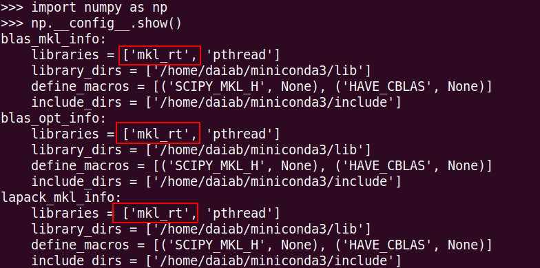
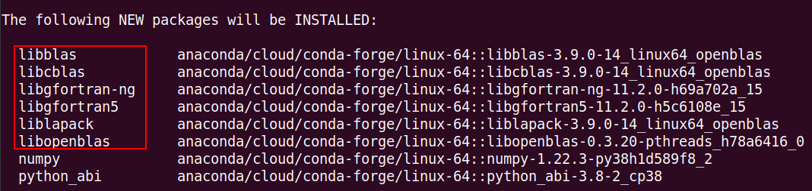
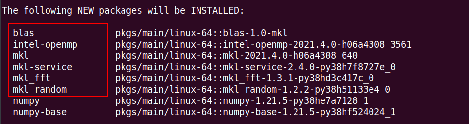

> 先使用`nvidia-smi -l 1`命令查看GPU使用率，如果GPU使用率为0优先检查代码是否调用了GPU进行计算。如果GPU使用率已经为90%+，则可以考虑换多卡并行或更高算力的GPU。

发现训练速度明显很慢时，可以先用以下代码进行压测排除硬件问题，观察GPU的使用率：

```
import torch
m = k = n = 8192
a = torch.zeros(m, k, dtype=torch.float32).cuda("cuda:0")
b = torch.zeros(k, n, dtype=torch.float32).cuda("cuda:0")
for _ in range(100):
    y = torch.matmul(a, b)
torch.cuda.synchronize("cuda:0")
```

## 瓶颈分析

首先确认您正在训练的模型具备什么样的特点，在性能上可以分为以下几种情况：

1. 小模型、数据预处理简单。比如用LeNet训练MNIST，这种情况优化的余地小，因为模型本身对算力的需求小，适合用一般的GPU来训练即可，用越好的GPU使用率会越低。这种场景GPU的使用率特点是保持在一个较低的水平，但是波动小。
2. 小模型、数据预处理较复杂。比如用ResNet18层网络跑ImageNet分类，这种情况CPU预处理会占用更长周期，而GPU的计算非常快占用时长短，因此适合选择更好的CPU和一般的GPU。这种场景GPU的使用率特点是波动大，峰值比较高，然后大部分时间都很低。
3. 大模型、数据预处理简单。这种情况一般GPU都会利用很高且波动小，但是对磁盘的要求也很高，如果利用率低那么请参考下述的方法压榨性能。
4. 大模型，数据预处理复杂。这种情况对CPU和GPU的要求都很高，都可能成为瓶颈，包括磁盘性能，需具体算法具体分析。

对于以上1和2两种情况，优化余地较小，更适合从选择主机下手配合代码优化，提高经济性。对于3和4如果发现GPU利用率较低时可以按下述方法排查瓶颈，优化性能。

> 如果GPU始终没有利用率，请确认：3060、3090、3080Ti、4090、4090D、A4000、A5000、A40、A100、A800、L20、H20、H800等安培架构的卡需要**cuda11.x**才能使用（最好cuda11.1及以上），请使用较高版本的框架。

**Step.1 查看GPU的利用率**

在终端中执行`nvidia-smi -l 1`命令

```
user@seeta:/tmp/test_directory$ nvidia-smi -l 1
Mon Nov  8 11:55:26 2021       
+-----------------------------------------------------------------------------+
| NVIDIA-SMI 440.82       Driver Version: 440.82       CUDA Version: 10.2     |
|-------------------------------+----------------------+----------------------+
| GPU  Name        Persistence-M| Bus-Id        Disp.A | Volatile Uncorr. ECC |
| Fan  Temp  Perf  Pwr:Usage/Cap|         Memory-Usage | GPU-Util  Compute M. |
|===============================+======================+======================|
|   0  TITAN X (Pascal)    Off  | 00000000:01:00.0  On |                  N/A |
| 31%   57C    P0    66W / 250W |    408MiB / 12194MiB |      2%      Default |
+-------------------------------+----------------------+----------------------+
|   1  TITAN X (Pascal)    Off  | 00000000:04:00.0 Off |                  N/A |
| 93%   27C    P8    11W / 250W |      2MiB / 12196MiB |      0%      Default |
+-------------------------------+----------------------+----------------------+

+-----------------------------------------------------------------------------+
| Processes:                                                       GPU Memory |
|  GPU       PID   Type   Process name                             Usage      |
|=============================================================================|
|    0      1450      G   /usr/lib/xorg/Xorg                            32MiB |
|    0      2804      G   /usr/lib/xorg/Xorg                           351MiB |
+-----------------------------------------------------------------------------+
```

如果GPU占用率为0说明代码可能没有使用GPU，需检查代码。

如果GPU占用率忽高忽低、占用率峰值在50%以下，那么可能是数据预处理跟不上GPU的处理速度，请看下述步骤。

**Step.2 查看CPU的占用率**

请在控制台 -> 容器实例中找到实例监控按钮。

<Frame>
  
</Frame>

查看CPU的使用：

2. 假设您的实例核心数为5，如果CPU占用率接近500%（即5个核心都正在高负载使用）那么可能是CPU数量不够，CPU出现了瓶颈，此时您可以迁移实例到更高CPU数量的主机上去或者升配。如果CPU占用率远没有达到500%的，说明您的代码没有把CPU的算力压榨出来，一般可以通过修改Torch Dataloader中的worker_num提高CPU负载，经验值num_worker = 略小于核心数量，最好测试不同worker num值对性能的影响。

**Step.3 检查代码**

如果上述步骤都没有解决问题，那么请调试代码，找到耗时的代码行做进一步分析。通常代码级别有几种常见的对性能有影响的写法，请自查：

1. 每次迭代中做一些与计算无关的操作。比如保存测试图片等等，解决办法是拉长保存测试图片的周期，避免每次迭代都做额外耗时的操作
2. 频繁保存模型，导致保存模型占用了训练过程一定比例的时间
3. PyTorch的官方性能优化指南：[查看](https://pytorch.org/tutorials/recipes/recipes/tuning_guide.html)
4. TensorFlow的官方性能优化指南：[查看](https://www.tensorflow.org/guide/function)
5. 同时欢迎在网站提交反馈其他case，共享知识

## 其他

### NumPy版本问题

> 初步鉴别方法：CPU负载非常高，所有核心跑满，并且升配更多核心后依然轻松跑满CPU，而GPU的负载一直较低。而且使用的是INTEL的CPU，那么有比较大的可能性是NumPy版本问题导致的性能问题。

NumPy会使用OpenBlas或MKL做计算加速。Intel的CPU支持MKL，AMD CPU仅支持OpenBlas。如果使用Intel的CPU，MKL会比OpenBlas有几倍的性能提升（部分矩阵计算），对最终的性能影响非常大。一般来说AMD CPU使用OpenBlas会比Intel的CPU使用OpenBlas更快，因此不用过份担心AMD CPU使用OpenBlas的性能差。

如果您在使用Intel CPU，先验证自己使用的NumPy是MKL还是OpenBlas版本。

<Frame>
  
</Frame>

有以上mkl字样代表是MKL的版本。

在使用清华等国内的Conda源时，安装NumPy时默认会使用OpenBlas的加速方案，您使用`conda install numpy`安装时会发现如下OpenBlas相关的包：

<Frame>
  
</Frame>

所以为了安装MKL的NumPy，解决方法如下：

```
# 第一步：卸载当前的NumPy
pip uninstall numpy (如果是conda安装的， conda uninstall numpy)
# 第二步：删除国内的Conda源
echo "" > /root/.condarc
# 第三步：重新安装NumPy
conda install numpy
```

如果以上步骤正确，那么在install numpy时将会看到：

<Frame>
  
</Frame>

### PyTorch线程数问题

> 初步鉴别方法：如果租用了多卡实例，并且每块卡跑不同的实验，那么可能是该问题

由于默认情况下，PyTorch会创建与核数相同的线程数做相关的计算。如果在同实例中租多卡GPU，且不同GPU分别跑多个实验时，每个PyTorch进程都会默认创建与核数相同的线程数，导致系统大量时间陷入线程调度而非计算，计算速度大幅减慢，CPU与GPU利用率都很低。此时可以使用代码`torch.set_num_threads(N)`设置单个进程所开启的线程数解决该问题。

**更多经验**

1. 如果您在使用单机多卡并行，并且使用了PyTorch框架，那么一般将torch.nn.DataParallel (DP)更换为torch.nn.DistributedDataParallel (DDP)能提升性能。官方原文是：`DistributedDataParallel offers much better performance and scaling to multiple-GPUs. `
2. 如果使用RTX 3090等安培架构的NVIDIA GPU，使用最新版本的PyTorch 1.9和1.10相比1.7会有较大的性能提升，PyTorch 1.7和1.8性能较差。（关机后在更多操作中更换PyTorch1.10的镜像）
3. 平台使用上，如果你的算法是非常吃资源的类型，那么最好在多个实验同时调参时，选择在不同主机上开多个实例，每个实例中跑一个实验，而避免在同主机上开实例或者同实例中租多卡GPU，不同GPU分别跑实验。
