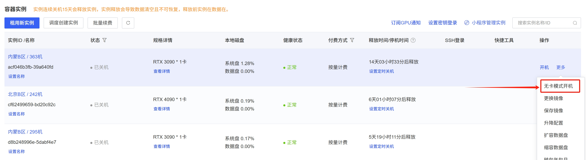

## 场景一

如果在编写/调试代码、上传下载数据到实例、给他人做代码展示等不需要GPU卡场景时，可以关机后使用`无卡模式`开机，无卡模式开机的区别在于对于这次开机会使用`0.5核；2GB内存；无GPU卡`的配置，价格统一为￥0.1/小时，对于实例之前和之后的数据均无影响，今后仍然可以使用正常的模式开关机。使用方法：

<Warning>
  同一主账号同时只能有2个无卡模式实例。无卡模式会释放GPU，置GPU为空闲状态，正常开机时如果GPU被其他用户租用，可能出现空闲GPU不足的情况。此时可以等待GPU释放或[克隆实例](/instance/migrate/migrate_instance_2)
</Warning>



## 场景二

一开始仅需要1块GPU进行代码调试和性能验证，但是调试完成后为了加速训练需要使用多卡并行，此类场景则可以使用升降配置的功能配置合适的GPU数量达到省钱的目的。使用方法参考 [升降配置](/instance/configuration/update_config)

## 场景三

不确定自己的代码需要执行多久结束，希望执行完成后立马关机。这类场景可以通过`shutdown` (最好使用命令完整路径: `/usr/bin/shutdown`)命令来解决。

<Warning>
  请保存好程序的日志，自动关机后标准输出中的日志将不再可见
</Warning>

```
# 假设您的程序原执行命令为
python train.py

# 那么可以在您的程序后跟上shutdown命令
python train.py; /usr/bin/shutdown      # 用;拼接意味着前边的指令不管执行成功与否，都会执行shutdown命令
python train.py && /usr/bin/shutdown    # 用&&拼接表示前边的命令执行成功后才会执行shutdown。请根据自己的需要选择
```

或者在您的Python代码中执行shutdown命令，例如：

```
import os

if __name__ == "__main__":
    # xxxxxx
    os.system("/usr/bin/shutdown")
```
<Tip>
建议先运行一个几分钟的测试代码，保证可以正常触发关机后再运行长时间的任务
</Tip>