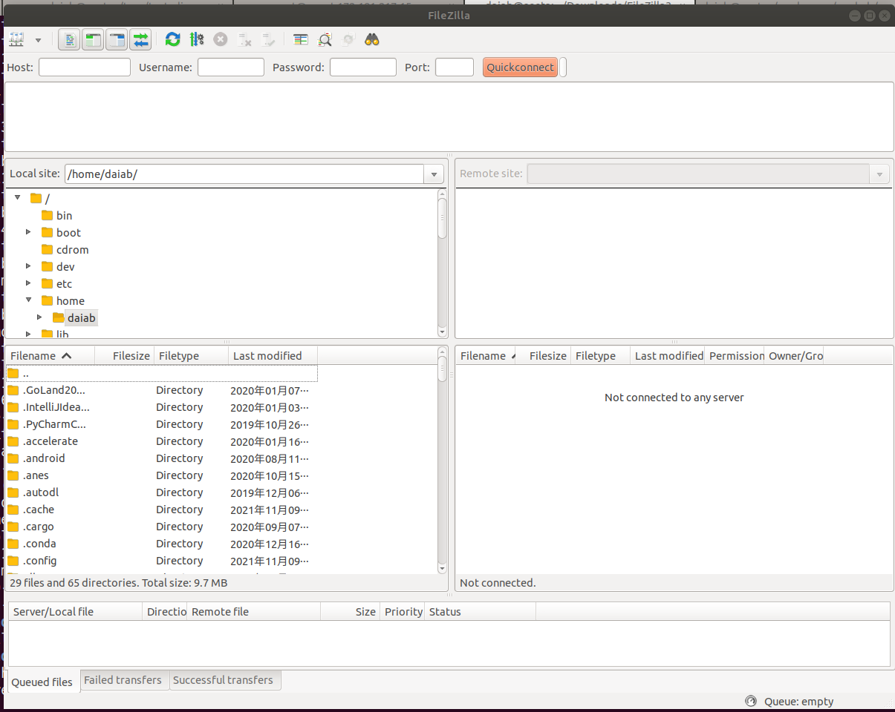
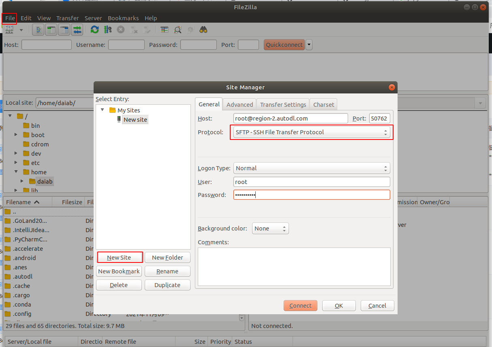
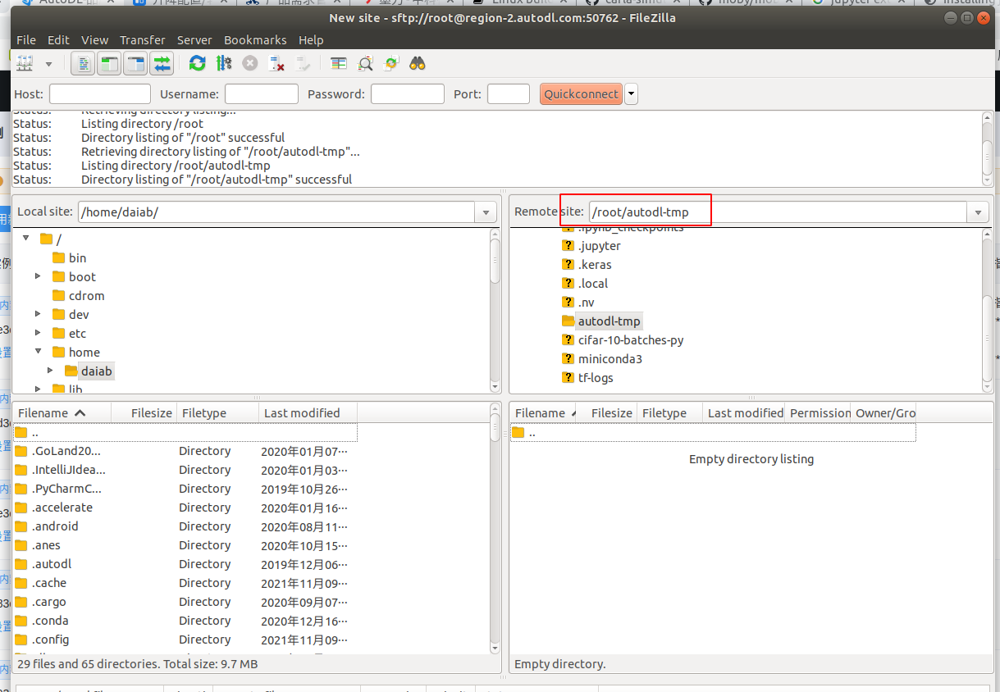

如果想更方便从实例上传和下载文件/文件夹，那么可以使用FileZilla：免费、全平台(Mac、Linux、Windows)。

**Step1.安装**

[下载地址](https://www.filezilla.cn/download/client)。另外Linux最简单的安装方式：`sudo apt install filezilla`

安装后启动界面为：

<Frame>
  
</Frame>

**Step2.连接**

复制自己实例的SSH指令，比如：`ssh -p 50762 root@region-2.autodl.com `

>在`ssh -p 50762 root@region-2.autodl.com`命令中， 各个参数的含义为：
>
>用户名：root
>
>HOST： region-2.autodl.com
>
>端口号：50762

从[File] - [Site Manager]打开下面的弹窗。

注意：要选择SFTP协议。

<Frame>
  
</Frame>

<Frame>
  
</Frame>

接下来就可以拖拉拽传输文件/文件夹了
