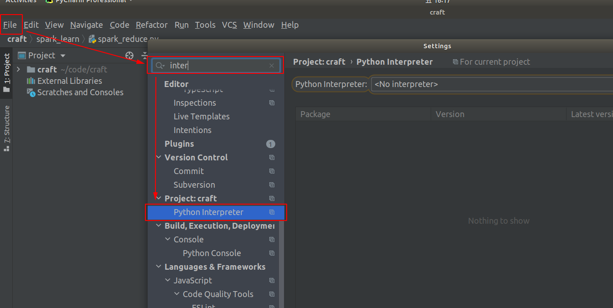
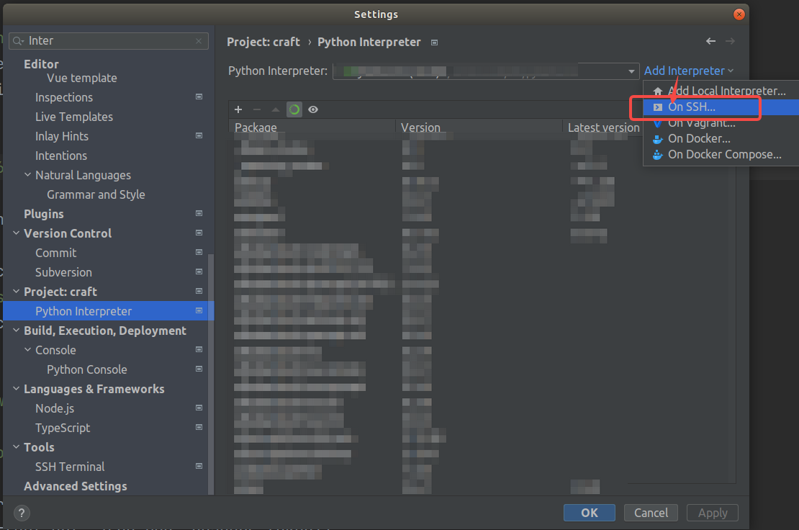
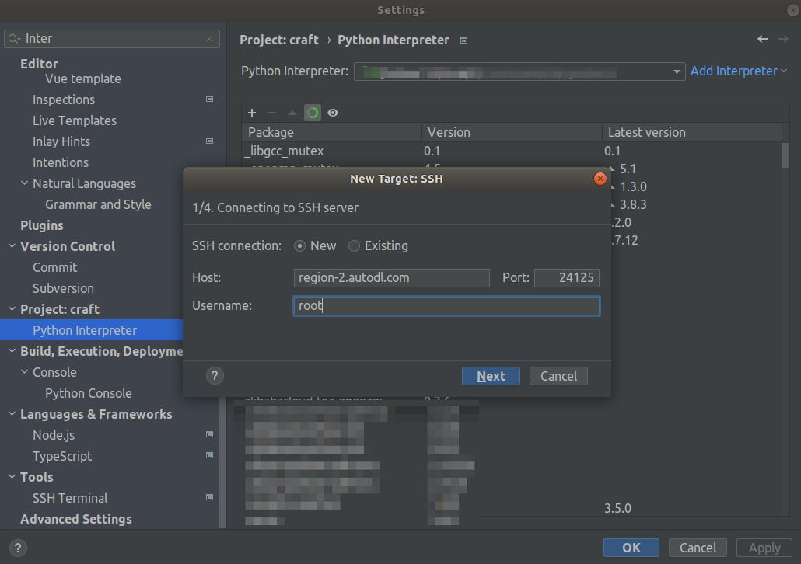
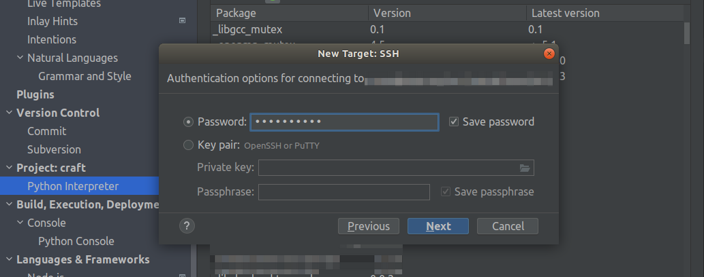
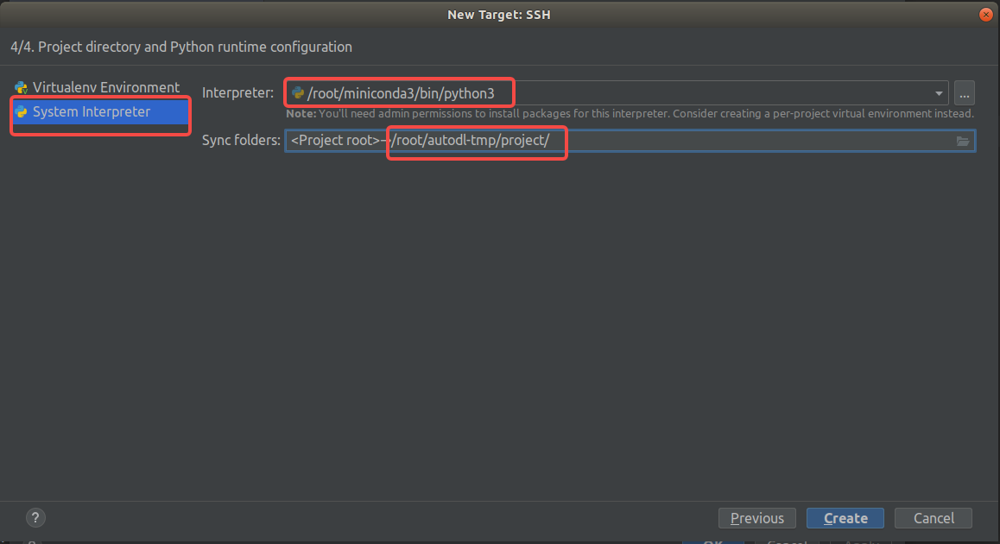
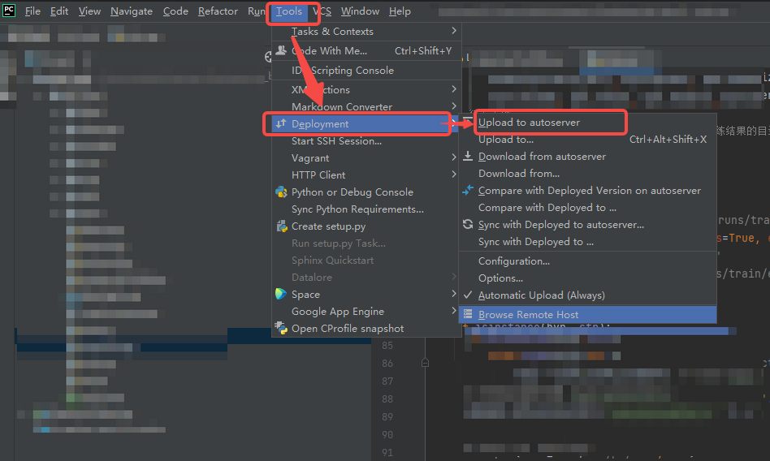
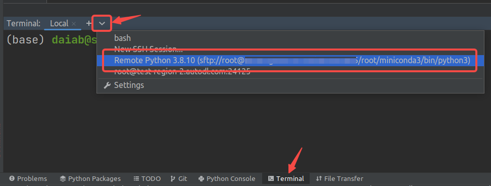

>  警告：如果使用PyCharm直接执行或开终端执行训练程序，请在调试完成后最后通过screen/tmux工具开守护进程（参考文档：[守护进程](/daemon)），确保程序不受SSH连接中断影响程序执行！

## 远程项目开发

官方文档：[请戳](https://www.jetbrains.com/help/pycharm/configuring-remote-interpreters-via-ssh.html)

AutoDL使用方法：

**Step1**：确认您安装的PyCharm是社区版还是专业版，只有**专业版**才支持远程开发功能。

**Step2**：开机实例

复制自己实例的SSH指令，比如：`ssh -p 38076 root@region-1.autodl.com `

>在`ssh -p 38076 root@region-1.autodl.com`命令中， 各个参数的含义为：
>
>用户名：root
>
>HOST： region-1.autodl.com
>
>端口号：38076

**Step3**：配置PyCharm

[File] -> [Settings]，打开以下设置弹窗，搜索interpreter找到[Python interpreter]设置项

<Frame>
  
</Frame>

点击Add Interpreter，选择On SSH并点击 (PyCharm社区版本无该选项)

<Frame>
  
</Frame>

将实例SSH指令中的Host、Port与Username进行匹配和填写（Username均为root，Host和Port查看自己实例的SSH指令)

<Frame>
  
</Frame>

下一步：输入SSH的密码

<Frame>
  
</Frame>

继续下一步，直到看到下面的弹窗。选择System Interpreter，配置远程Python解释器地址为`/root/miniconda3/bin/python`（如果您在miniconda中安装了其他的虚拟环境，那么虚拟环境的python解释器路径在/root/miniconda3/envs/{对应的虚拟环境名称}/bin/python）

配置同步目录，意思是本地项目和远程实例中的哪个目录进行关联，这里设置为实例的数据盘子目录：`/root/autodl-tmp/project/` （不建议使用默认的/tmp目录）

<Frame>
  
</Frame>

点击创建，如果配置均无误PyCharm会有小会配置过程，完成后即可远程开发。

如果您在运行时找不到Python文件，可能是没有自动同步代码，那么可以选择手动同步：

<Frame>
  
</Frame>

## 打开远程终端

配置好PyCharm远程开发后，可以在PyCharm的终端中下拉找到远程服务器打开远程终端：

<Frame>
  
</Frame>

 
