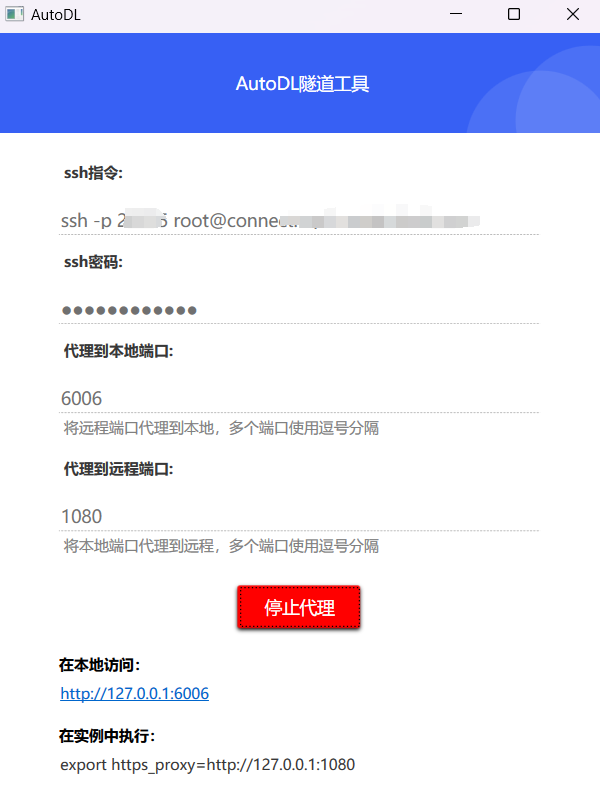
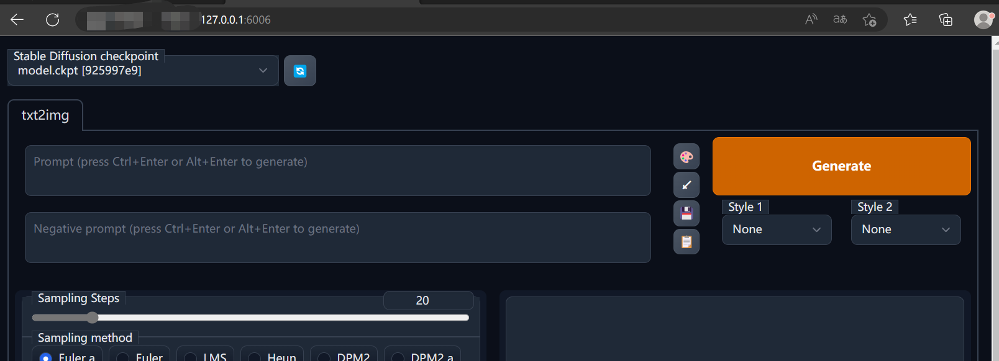
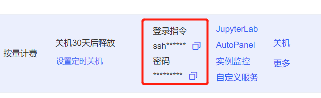

SSH隧道可以将实例的端口代理到本地，或者代理本地端口到实例。下面介绍两种方式，一种为终端命令的方式（适合Linux/Mac用户），另一种为图形工具的方式（仅能用于Windows）

## 图形工具

Windows客户端（免安装）：<a href="https://autodl-public.ks3-cn-beijing.ksyuncs.com/tool/AutoDL-SSH-Tools.zip" target="_blank">点击下载</a>

下载后解压，无需安装点击exe可执行文件即可，输入要代理的端口号，如果有多个端口号用英文逗号`,`分隔。工具可将实例中的端口代理到本地，或者将本地端口代理到实例中



## SSH代理命令

### 代理实例中的端口到本地

具体步骤为：

**Step.1** 在**实例中**启动您的服务（比如您的服务监听6006端口，下面以6006端口为例）

**Step.2** 在**本地电脑**的终端(cmd / powershell / terminal等)中执行代理命令：

`ssh -CNg -L 6006:127.0.0.1:6006 root@123.125.240.150 -p 42151`  

其中`root@123.125.240.150`和`42151`分别是实例中SSH指令的访问地址与端口，请找到自己实例的ssh指令**做相应替换**。`6006:127.0.0.1:6006`是指代理实例内`6006`端口到本地的`6006`端口。

<Note>
  注意：执行完这条ssh命令，没有任何日志是正常的，只要没有要求重新输入密码或错误退出

  Windows下的cmd/powershell如果一直提示密码错误，是因为无法粘贴，手动输入即可（正常不会显示正在输入的密码) 
</Note>


**Step.3** 在本地浏览器中访问`http://127.0.0.1:6006`即可打开服务，注意这里的`6006`端口要和上述`6006:127.0.0.1:6006`中的端口保持一致



### 代理本地端口到实例

```bash
# 上面代理实例中的端口到本地的Step.2中的命令：
ssh -CNg -L 6006:127.0.0.1:6006 root@123.125.240.150 -p 42151

# 只需将上面的命令修改参数-L为-R即代理本地端口到实例
ssh -CNg -R 6006:127.0.0.1:6006 root@123.125.240.150 -p 42151
```

### 常见问题

1. SSH指令在哪里获取？
   
   

2. Windows下执行ssh代理时权限报错？
   
   一般有两种错误
   
   第一种：
   
   ```
   It is required that your private key files are NOT accessible by others.
   This private key will be ignored.
   Load key "C:\\Users\\Administrator/.ssh/id_rsa": bad permissions
   ```
   
   解决方法：修改报错信息中的`C:\\Users\\Administrator/.ssh/id_rsa`文件为只读文件
   
   第二种：
   
   ```
   Bad owner or permissions on C:\\Users\\Administrator\\.ssh\\config
   ```
   
   解决方法：删除该config文件`C:\\Users\\Administrator\\.ssh\\config`文件为只读文件

3. SSH指令的各个参数什么含义？
   
   SSH指令复制出来为形如该格式的命令：`ssh -p 48332 root@region-3.autodl.com` 
   
   <Note>
     在ssh -p 48332 root@region-3.autodl.com命令中， 各个参数的含义为：

     用户名：root

     主机host： region-3.autodl.com

     端口号：48332
   </Note>
   
   那么ssh隧道的命令为（假设为代理实例中的6006端口到本地）
   
   `ssh -CNg -L 6006:127.0.0.1:6006 root@region-3.autodl.com -p 48332`
