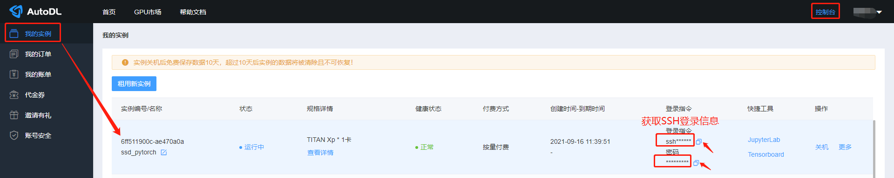
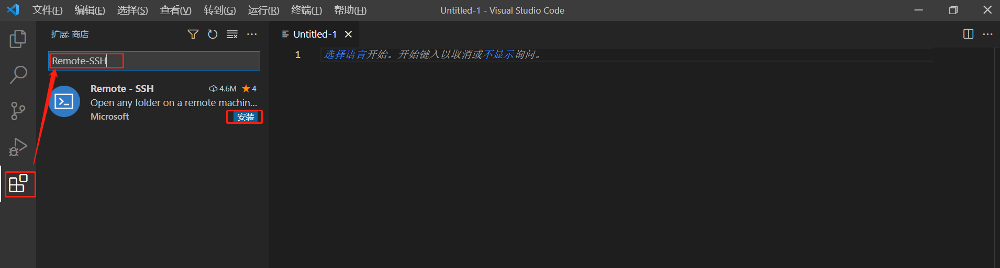
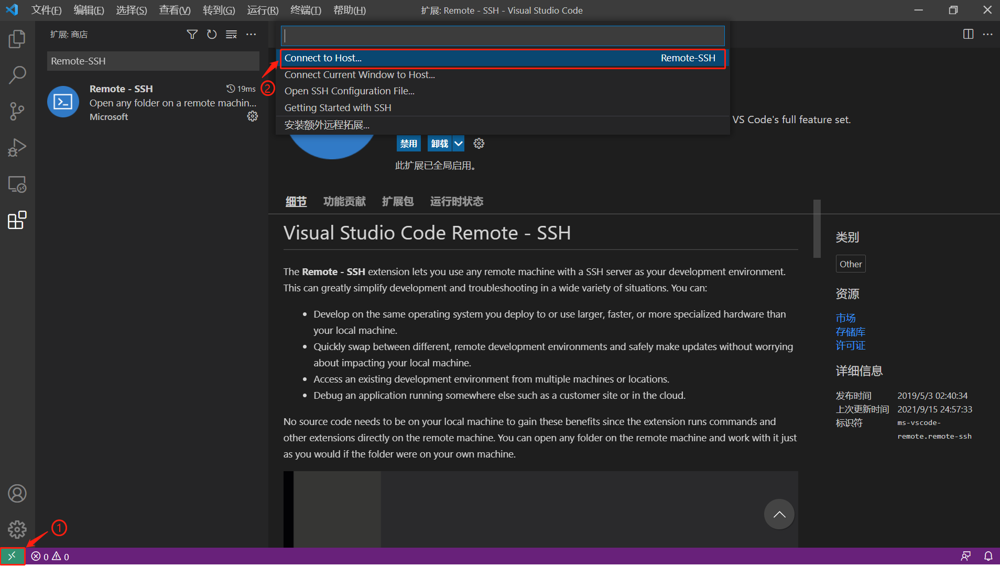
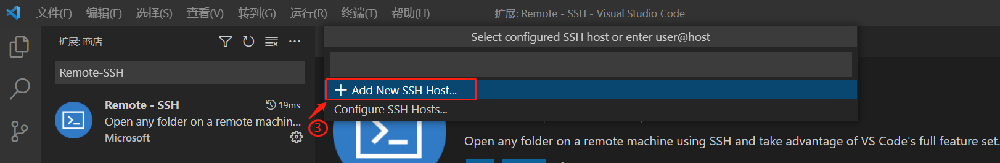
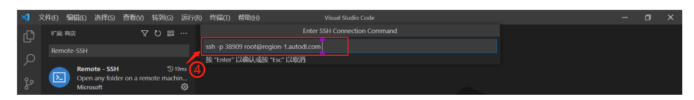
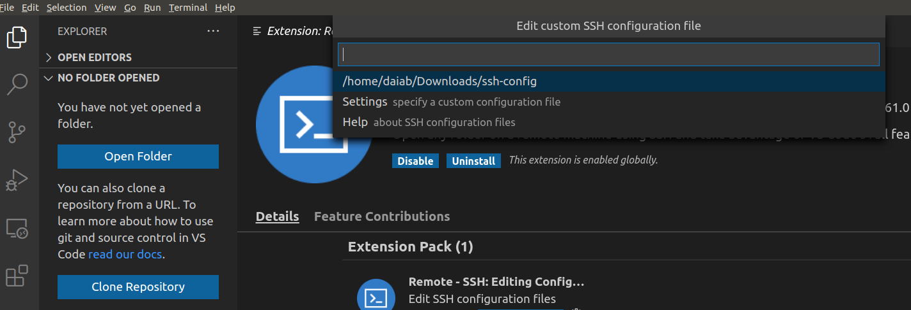
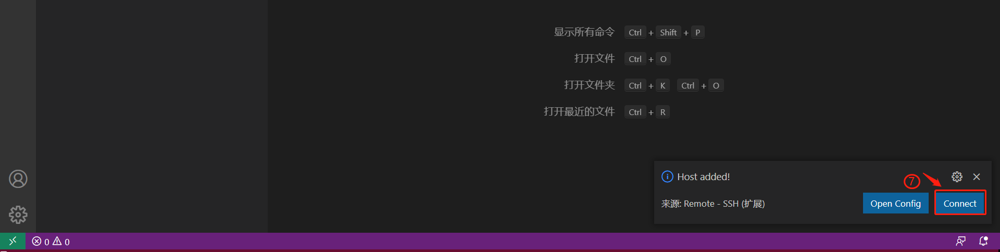
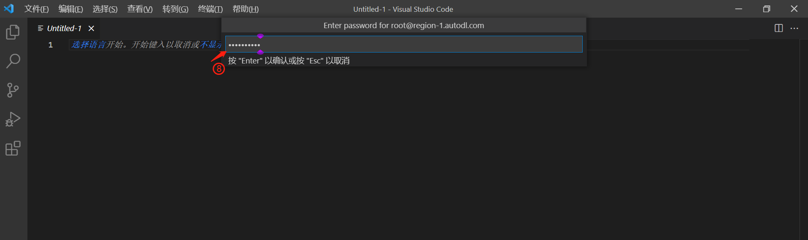
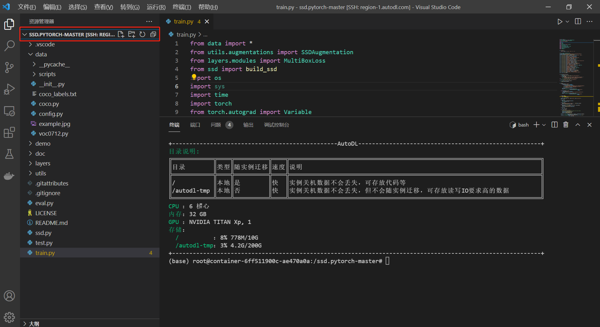

>   警告：如果使用VSCode直接执行或开终端执行训练程序，请在调试完成后最后通过screen/tmux工具开守护进程（参考文档：[守护进程](/daemon)），确保程序不受SSH连接中断影响程序执行！

官方文档：[请戳](https://code.visualstudio.com/docs/remote/ssh-tutorial)

AutoDL使用方法：

在进行操作前您需要提前安装好VSCode，此外还需要您：

+ 在[AutoDL](https://www.autodl.com/login)租用并开机实例，获取实例的SSH登录信息（登录指令和登录密码）
+ 本地安装VSCode远程开发插件（需配置Remote-SSH）

## 1.登录AutoDL选择开机的实例

获取SSH登录信息

<Frame>
  
</Frame>

## 2.本地VSCode配置Remote-SSH

如果您本地VSCode开发工具已安装Remote-SSH，可跳过此步骤，直接参考 [步骤3]

打开您本地的VSCode开发插件菜单，在扩展程序中搜素`Remote-SSH`并安装

<Frame>
  
</Frame>

## 3.SSH连接并登录您远端租用的实例

按照图示进行点击，完成添加SSH主机

<Frame>
  
</Frame>

<Frame>
  
</Frame>

获取并复制您实例的SSH登录信息

图示以`ssh -p 38909 root@region-1.autodl.com`为例。回车键继续操作，**注意，如果这个ssh命令的最后有空格，请删除空格，否则可能无法登录**

<Frame>
  
</Frame>

回车后会弹出以下自定义SSH config 文件的弹窗，不需要选择直接回车即可。马上可能会弹出选择远程服务器是`Windows`、`Linux`和`Mac`系统的选项，请选择**`Linux`**

<Frame>
  
</Frame>

<Frame>
  
</Frame>

输入密码，等待SSH登录完成。

<Frame>
  
</Frame>

## 4.选择您的代码目录

图示代码已经上传到实例`/`目录中。如您还为上传资源，您可以参考[SCP远程拷贝文件](/scp)或[JupyterLab](/jupyterlab)章节内容上传代码

<Frame>
  
</Frame>

**建议：** **您在使用VSCode开发代码时，可根据开发语言配置相应的解释器。**
