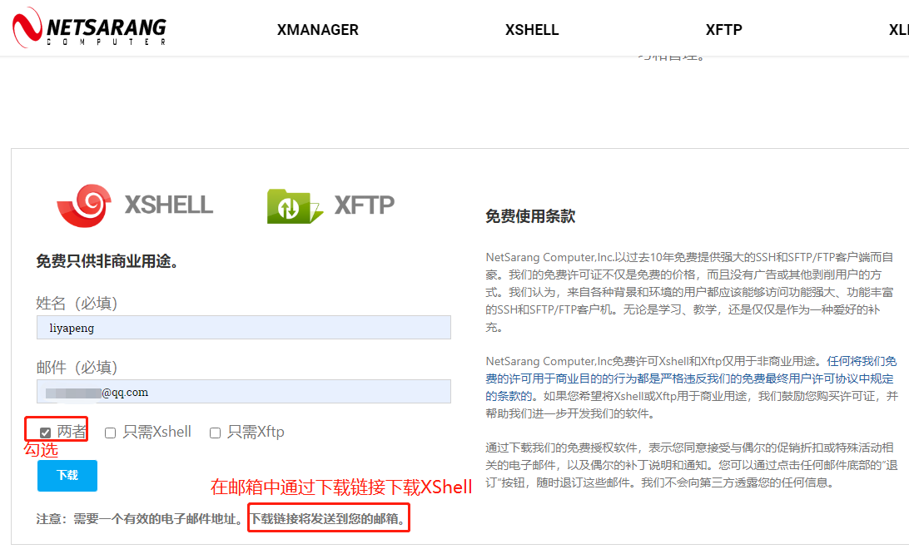
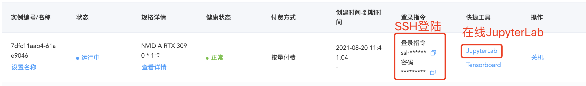
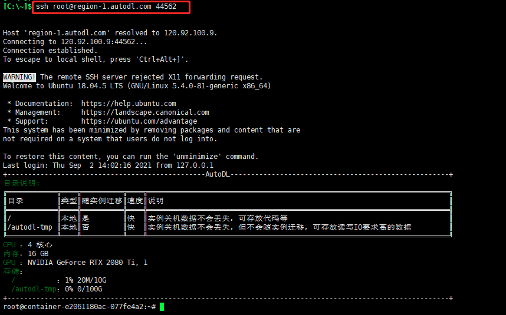
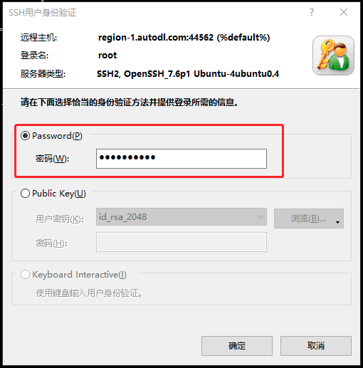
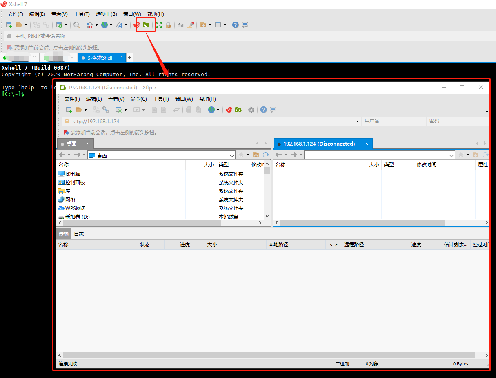

XShell是Windows系统中非常好用的远程管理软件，功能强大方便。

## XShell安装

XShell是付费版软件，但是可以通过官方途径申请免费许可证。方式如下：

Step1. <a href="https://www.xshell.com/zh/free-for-home-school/" target="_blank">访问网址</a> 按照要求填写邮箱地址信息，比如：

<Frame>
  
</Frame>

Step2. 使用官方给邮件中发送的链接进行下载并安装使用。注意：安装过程中会询问是否购买付费版本，请选择否即可。

## XShell使用

开机实例后，找到SSH登录指令

<Frame>
  
</Frame>

> 注意SSH登录指令中的端口等需要更换您的实例对应的信息

复制登录指令为(具体请以您的实例为准)：`ssh -p 44562 root@region-1.autodl.com` 。由于XShell命令格式较特殊，需要您手动修改格式为: `ssh root@region-1.autodl.com 44562` 即将端口号置于末尾，无需添加`-p`参数。例如：

<Frame>
  
</Frame>

其中在键入ssh命令后回车会弹出输入密码的弹窗：

<Frame>
  
</Frame>

## XShell传输文件

如果已经配置了SSH登录，那么可以使用XShell提供的xftp进行文件传输，方式如下：

<Frame>
  
</Frame>
