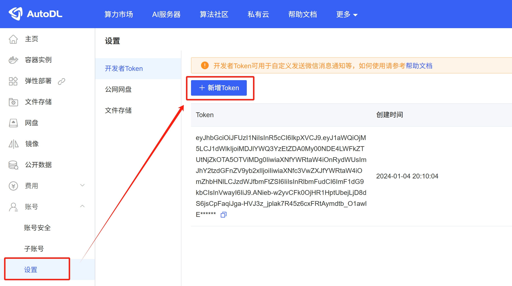
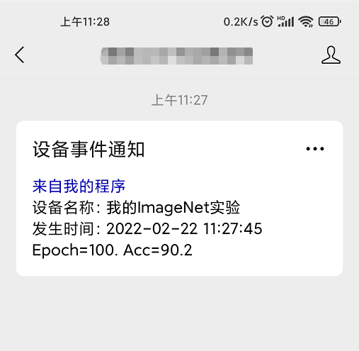

*微信对模板消息进行了功能阉割，首行和尾行信息不再可见，详细参考[微信开发者文档](https://developers.weixin.qq.com/community/develop/doc/000a2ae286cdc0f41a8face4c51801?blockType=1)*

<Danger>
  严肃声明：消息中不得出现违法和不良信息，否则产生的法律后果由您自己承担！
</Danger>

AutoDL为您提供代码自定义发送微信消息通知的功能，使用场景有：

1. 发送模型训练中重要的metric数据到您的微信，及时了解模型的训练过程
2. 发送异常程序中断消息到您的微信，及时修改代码或结束计费，避免空置损失
3. 其他（即使您不租用AutoDL的GPU实例，也欢迎您使用该功能）

注意：为了规范消息使用，每日推送消息数量不超过**50条**，每分钟内不超过**5条**（发送成功的消息才会计数）。

## 使用方法

1. 注册AutoDL帐号后绑定微信（控制台 -> 帐号安全菜单）

2. 获取开发者Token，方法见下图

   

### POST请求发送消息

```
# python脚本示例

import requests
headers = {"Authorization": "获取到的Token"}
resp = requests.post("https://www.autodl.com/api/v1/wechat/message/send",
                     json={
                         "title": "eg. 来自我的程序",
                         "name": "eg. 我的ImageNet实验",
                         "content": "eg. Epoch=100. Acc=90.2"
                     }, headers = headers)
print(resp.content.decode())
```

以上参数中`title`是必填，其他均为选填。

如果发送成功，那么您在AutoDL微信公众号中将会收到如下消息：



     
