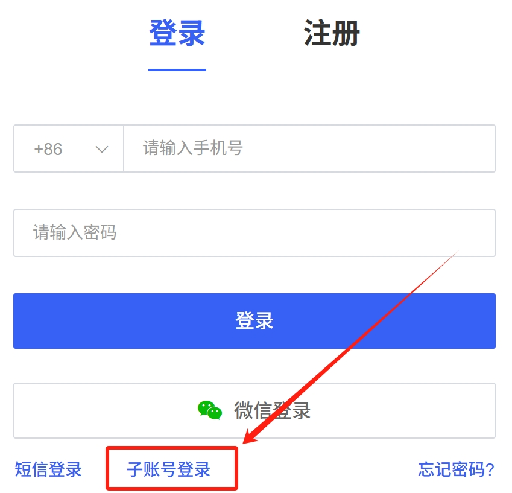

<Info>
  子账号可用于更加复杂的账号与权限管理，子账号功能特性如下:

  1.集中管理子账号及其密码

  2.集中管理子账户对实例和文件存储等的访问权限

  3.由主账号结算费用和账单等，子账号只需专注于业务使用

  4.清除子账号时，实例和数据等不会受此影响而丢失

  5.配置简单易用
</Info>

## 开通子账号功能

子账号都是由主账号创建，入口在「控制台」-> 「账号」-> 「子账号」。每个账号默认可创建10个子账号，如果额度用完请**联系客服**。

子账号可以在子账号登录入口进行登录。

## 子账号的权限

子账号权限由主账号配置，可配置权限的项目：

1. **容器实例**：可配置子账号是否可以使用容器实例功能。其次可以更细粒度配置容器实例与子账号之间的可见性。
2. **弹性部署**：可配置子账号是否可以使用弹性部署功能。
3. **镜像**：可配置子账号是否可以使用镜像功能。
4.  **文件存储**：可配置子账号是否可以使用文件存储功能。
5. **费用账单**：可配置子账号是否可以管理账单费用相关功能。打开该功能，则可以进行充值、管理账单、开具发票等。
6. **共享主账号余额**：开启后子账号看到和可使用的余额为主账号余额。否则为子账号的虚拟余额。
7. **限制子账号的消费**：支持给子账号配置虚拟余额或者共享主帐号的余额，对子账号的消费金额进行限制。可查看子账号的总消费金额。子账号的消费金额计入逻辑：如果某实例的访问权限为某子账号所有，那么该实例产生的相关费用均计入该子账号的消费金额，但是由于包年包月转按量计费产生的退款不会再退回子账号的虚拟余额，其他如文件存储的费用均不计入任何子账号。如果为子账号设置独立的虚拟余额后，可以设置`余额不足强制关机`的选项，如果设置为`是`，那么子账号创建的实例在子账号的虚拟余额不足后会强制关机（包年包月还未到期的实例除外）。

其他说明：

1. 不在以上权限控制项目中的，子账号全部共享主帐号的资源，即子账号和主帐号没有差异。
2. 删除子账号，所有原子账号可访问的资源不受影响仍然存在，且仅主帐号可见（其他子账号权限不变）。
