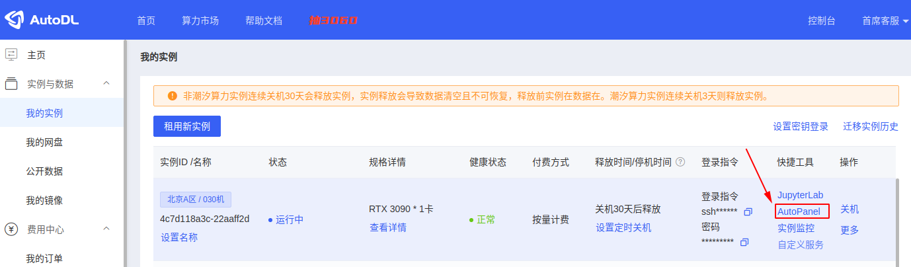
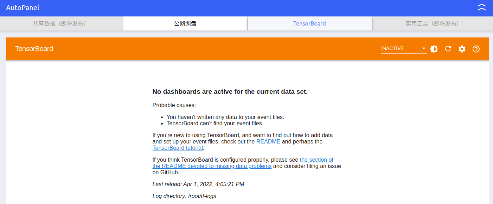

## 默认打开方式

AutoDL实例中已内置TensorBoard工具，您只需将tensorboard的event文件保存到/root/tf-logs/路径（如果您希望使用其他的logs文件夹，请看下方切换目录），或者将保存到其他路径的event文件拷贝到该路径下，然后使用tensorboard。

开机实例后，找到AutoPanel访问入口：

<Frame>
  
</Frame>

<Frame>
  
</Frame>

## 切换tf logs目录

如果您希望使用其他的logs目录，那么你可以手动再启动一个TensorBoard：

```
首先结束默认启动的TensorBoard进程，执行命令：ps -ef | grep tensorboard | awk '{print $2}' | xargs kill -9 
在终端中执行以下命令启动TensorBoard
$ tensorboard --port 6007 --logdir /path/to/your/tf-logs/direction
```

启动后重新在AutoPanel中访问TensorBoard即可。
