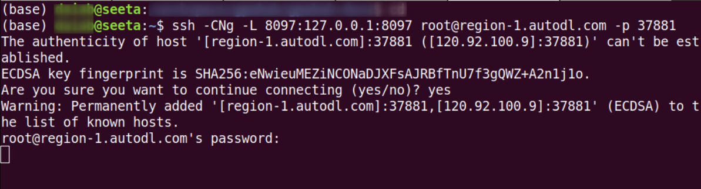
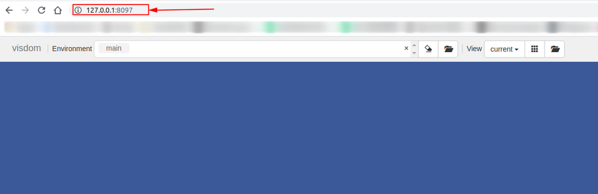
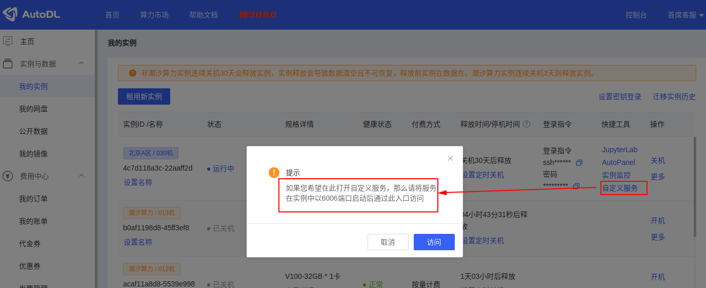
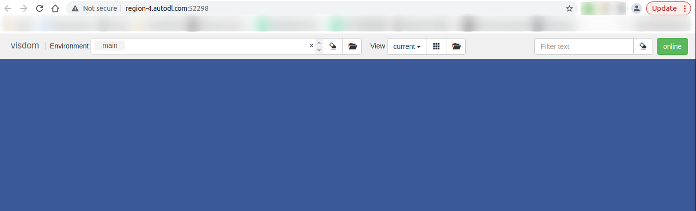

## SSH隧道的方法

1. 在**实例中**启动visdom（默认会监听8097端口）

2. 在**本地电脑**的终端中执行命令：`ssh -CNgv -L 8097:127.0.0.1:8097 root@region-1.autodl.com -p 37881`。其中`8097:127.0.0.1:8097`是指代理Visdom Server的8097端口到本地的8097端口，`root@region-1.autodl.com`和`37881`分别是实例中SSH指令的访问地址与端口，请进行相应替换。

   <Note>
     注意：执行完上面这条ssh命令，没有任何日志是正常的，只要没有要求重新输入密码或退出。
   </Note>

   

3. 在本地浏览器中访问`127.0.0.1:8097`即可打开Visdom

   

## 自定义服务方法

开机实例，找到「自定义服务」入口



从提示可看出，我们只需将Visdom启动在6006端口即可从「自定义服务」入口访问：

在实例中启动Visdom，并且指定端口为6006

```
# 如果没有安装visdom，请先执行pip install visdom安装
# visdom -port 6006
Checking for scripts.
It's Alive!
INFO:root:Application Started
You can navigate to http://container-7e5111bf0c-8a82bc6b:6006
```
此外由于Visdom的客户端默认连接Visdom server时会使用原来的端口，因此在client代码中构造Visdom对象时需做如下修改：
```
vis = Visdom(server='http://localhost', port='6006', env='main')
```

启动后在本地浏览器访问自定义服务


