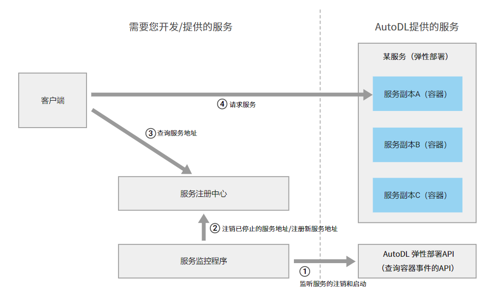

## 创建部署

如果您的需求是进行做一次性任务则推荐使用Container/Job类型的部署，如果是做服务部署那么推荐使用ReplicaSet类型的部署，因为ReplicaSet具备管理和维持容器节点副本的作用，即如果有某个容器出现异常退出，则系统自动拉起新容器进行替补。做服务部署时除了使用ReplicaSet的特性外，还需配合服务发现和负载均衡提升可靠性和可用性（请看下面小节）。

## 服务发现与负载均衡

在做ReplicaSet类型的弹性部署时，每个容器提供了一个独立的自定义服务地址（https协议）为外部提供服务，由于容器可能存在单点故障导致服务停止以及ReplicaSet类型的部署会启动新容器替补停止的容器，因此需要动态注销/注册每个容器的服务地址完成高可用的部署。

服务发现一般分为两种：客户端发现和服务端发现。这里考虑到简单好用，介绍一种客户端发现的实践方式，该方式较为适合GPU负载场景（计算负载高、GPU显存有限、单请求响应时间长），并且与负载均衡一同完成。架构如下：

从上图可看出，首先需要开发一个服务通过AutoDL提供的[查询容器事件](/api/esd_api_doc#查询容器事件)接口，轮询监听容器（这里暂且认为和服务等效）的状态，有停止的容器则从注册中心移除，有新的运行中的容器则注册到服务中心。

最后客户端在调用服务前，先从服务注册中心获取服务地址的列表，然后根据负载均衡策略从中挑选一个进行服务调用。由此可看出在此环节可一同完成负载均衡

**常见问题：**

Q1. 为什么AutoDL不提供负载均衡

A1：如果AutoDL提供负载均衡，则可以简化用户端的使用。但是常见的Nginx做负载均衡支持的策略有限，无法根据业务情况精确控制GPU的使用率，降本增效。

## 停止容器

在使用ReplicaSet弹性部署时，除了可以通过设置副本数量控制容器的启停以外，如果您还需要精确控制停止某个容器则可以通过调用[停止容器](/api/esd_api_doc#停止某容器)的接口完成停止，并且在该接口中提供了一个`decrease_one_replica_num`参数，该参数可以在停止容器的同时，将部署的replica num副本数减少1个，即停止该容器后不再启动新容器（该参数对ReplicaSet部署有效）

## 屏蔽故障机器

如果发现有规律性的在某台主机上调度启动的容器频繁发生异常，则可使用[设置调度黑名单](/api/esd_api_doc#设置调度黑名单)API禁用该机器

## 镜像与文件存储

在启动时系统会pull镜像启动容器，如果静态的、不需要经常变更的环境与其他数据文件可以存放于镜像中，避免镜像的频繁更新，由于每次更新后有一个重新缓存镜像到每台主机的过程，因此会影响第一次启动容器的时间。

如果经常变更的文件，如代码和模型文件，推荐存放于文件存储，文件存储作为跨实例的共享存储会挂载到同地区每个容器中，因此可以加以利用该特点简化管理和部署。但是文件存储也有缺点：性能相比本地盘慢，特别是对于非常多的小文件读写（kb级别的文件）性能较差，大文件的读写带宽约为100MB/s。如需增加性能请使用高速文件存储（北京B区）。

### 启动命令

1. 容器在启动后就会立即执行您设置的启动命令，命令结束容器也会停止并释放，即命令执行的生命周期=容器的生命周期。因此以`python app.py`命令为例，请勿将该命令以后台的方式执行，比如`python app.py &`，这样命令（父进程）会立即执行完成并将程序（子进程）挂在后台运行，但是此时由于命令已结束系统会停止容器导致所有进程一起终止，未能达到期望的效果。如果特殊原因需要以这种方式执行，那么trick为：`python app.py &; sleep infinity`
2. 如果您在启动时执行的命令非常多且复杂，建议您在镜像或文件存储中写一个shell脚本，将这些命令放于一个脚本中，这样容器的启动命令改为执行该脚本，让启动命令得到简化，避免出错。
3. 启动命令的执行相对路径：建议先切换到相应目录下再执行脚本。比如`python app.py`命令，`app.py`脚本在/root目录，那么命令最好写为`cd /root/ && python app.py`
4. 对于Conda使用虚拟环境的情况，在命令中这样写`conda activate my-env && python xxx.py`，一般会由于无法切换环境而执行失败，推荐您改为`/root/miniconda3/envs/my-env/bin/python xxx.py`，即直接使用虚拟环境的python解释器

## 异常调试

场景举例：容器的启动命令为`python app.py`，开始调度后容器开机运行但立即异常结束，原因未知。

调试方法：编辑部署，将容器的启动命令由`python app.py`改为`sleep infinity`，目的是用`sleep`命令阻塞容器使得它一直保持运行状态，此时等待容器运行后，用容器的ssh命令登录，手动在容器中执行`python app.py`命令来查看是否执行异常进行调试，如此可以以交互的方式高效定位问题。调试完成后编辑部署将命令改为正确的命令。

## 重要功能介绍

### 复用容器

在使用弹性部署的过程中，主要耗时在拉取镜像环节，镜像大小越大以及同时调度的容器越多对启动时间会产生较大影响。因此为缩短创建容器时间，支持了弹性部署复用已停止容器的功能。具体实现为：

1. 对于已经部署后停止的容器，系统会自动保留一段时间（该时间由系统策略确定，最长不超过7天）。这些容器会被放入待复用的容器池。

2. 当有新的容器需要创建时，会优先从待复用的容器池中找到符合当前部署条件的（根据镜像等参数）已经停止的容器，如果找到则直接将该老容器作为新容器启动，否则按原先的流程拉取镜像后创建新容器。

复用和不复用容器时的区别：

1. 接口上：除了创建部署的时设置的`reuse_container`参数有区别，其他所有接口均无区别，内部的差异由系统进行屏蔽。因此使用复用功能无需您改动其他接口的代码。

2. 数据上：由于复用原先的容器时，系统不会对原容器做数据清理（恢复至镜像的初始状态），因此存在上次使用该容器时残留的文件数据。如果该数据会对当次运行造成影响，需根据您的业务先验信息进行相应的删除，此外也可以加以利用该特性减少文件的重复拷贝。

3. 环境变量：用于记录容器UUID的AutoDLContainerUUID环境变量，无论是否复用都是唯一的值，不会使用老容器的UUID值。

使用方法：

在创建部署的时设置`reuse_container`为true就会自动启动该功能。该功能在部署级别生效，非全局参数。
