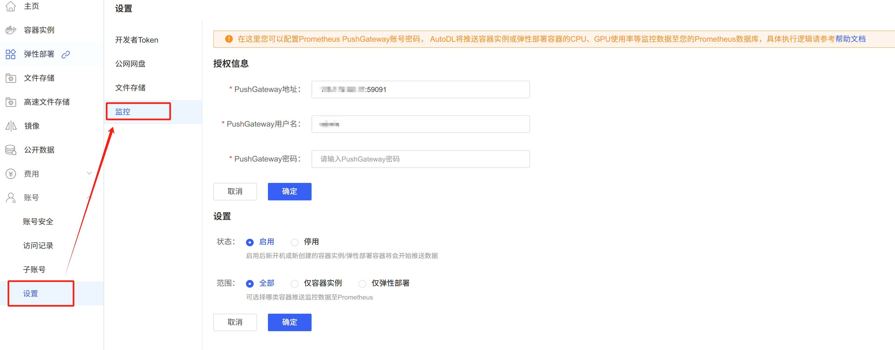
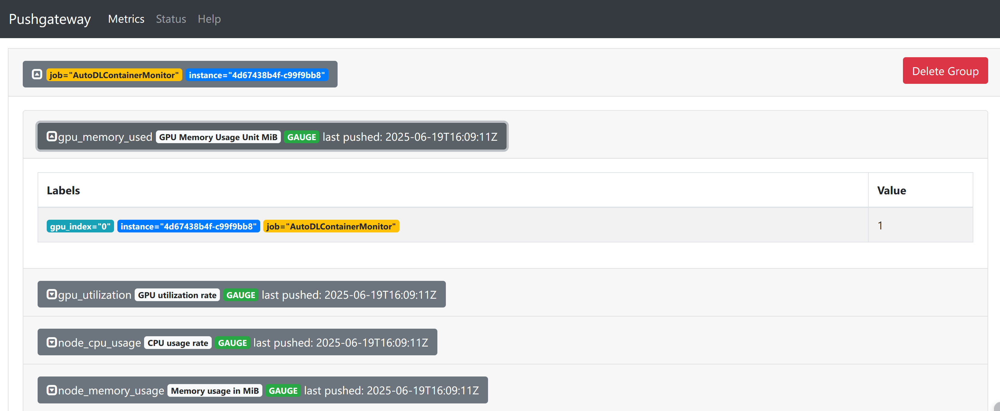

<Note>
  仅企业认证后的账号可用
</Note>

### 方式一：容器内API主动获取

使用以下代码在容器内（容器实例或者弹性部署的容器）执行获取CPU、内存、GPU监控信息

```python
import requests
import json

# url地址不同容器都一样，均使用127.0.0.1进行获取
url = 'http://127.0.0.1:2022/autopanel/v1/api/monitor/current'
response = requests.get(url)
content = response.content.decode()
if response.status_code == 200 and "success" in content:
    metric = json.loads(content)['data']
    print(f"CPU Usage: {metric['cpu_usage']} %")
    print(f"Mem Usage: {metric['memory_usage']} MiB")
    print("GPU Info:")
    gpu_metrics = metric.get('gpu_list', [])
    for gm in gpu_metrics:
        print(f"\tIdx:{gm['index']}  Mem Usage: {gm['memory_used']} MiB  Utilization: {gm['utilization']} %")
```

### 方式二：推送至Prometheus

您可以在AutoDL上配置托管您自己的Prometheus的PushGateway账号密码，AutoDL将自动推送容器的metric数据至您私有Prometheus数据库，进而您可以通过其他的技术栈比如Grafana查看所有容器的监控数据。注意：Prometheus、PushGateway、Grafana等均由您自己提供，AutoDL只进行数据的推送。

配置并开启推送监控数据到Prometheus



开启后新创建/重启的容器将会开始推送Metric数据



如何可视化这些Metric数据请使用Grafana等做进一步配置
