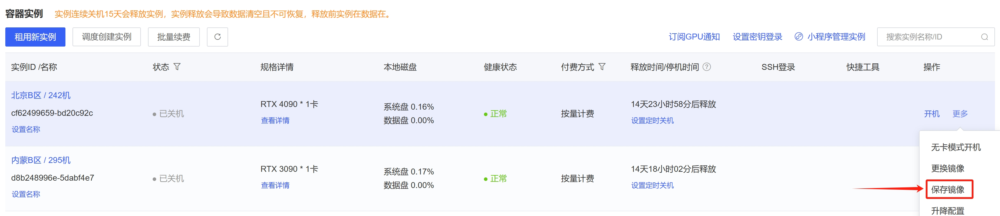
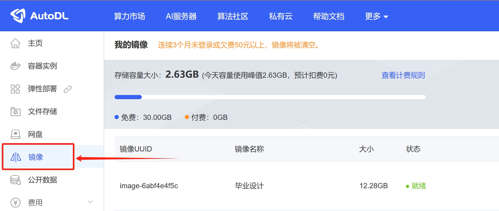
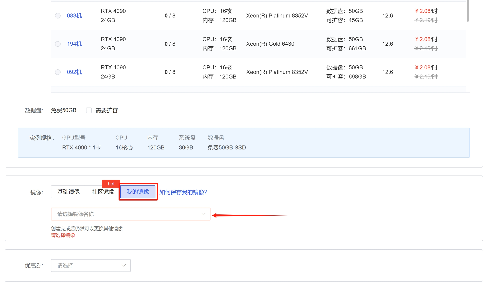
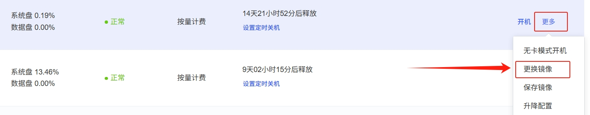
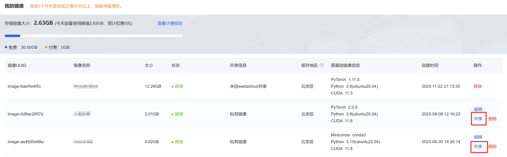
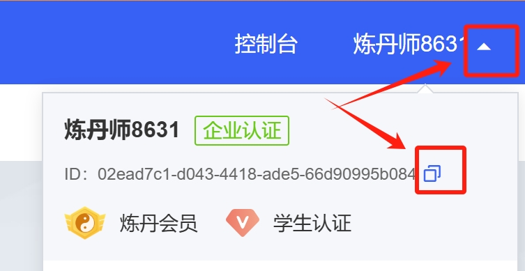

> 当前AutoDL不支持导入自定义镜像。

如果您在一个实例中配置好了环境等，在更换主机以及开新的实例时希望复用该环境，以及长期留存该环境以备日后使用，那么保存镜像将是最好的选择。此外还**支持共享镜像给其他用户**。

## 保存镜像

将某个实例关机后，在更多操作中点击「保存镜像」，则可以将该实例的整个系统盘保存下来（了解什么是[系统盘](/env)）

<Frame>
  
</Frame>

保存镜像后请在「镜像」菜单中查看。

<Frame>
  
</Frame>

## 加载镜像

租用新实例或者老实例选择更换镜像时，选择自己保存的镜像，这样即可恢复原来实例系统盘中的所有内容。

<Frame>
  
</Frame>

## 更换镜像

将实例关机后，在更多操作中点击更换镜像，更换镜像会**清空**系统盘，数据盘不受影响。（了解什么是[系统盘](/env)）

<Frame>
  
</Frame>

## 共享镜像

保存镜像后可以在操作中点击「共享」，共享给指定的用户。

<Frame>
  
</Frame>

对方用户ID可在页头用户名下拉窗口下获取。

<Frame>
  
</Frame>
