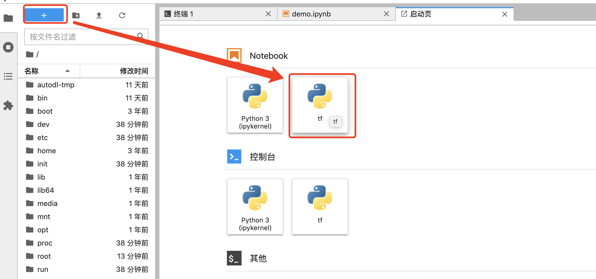
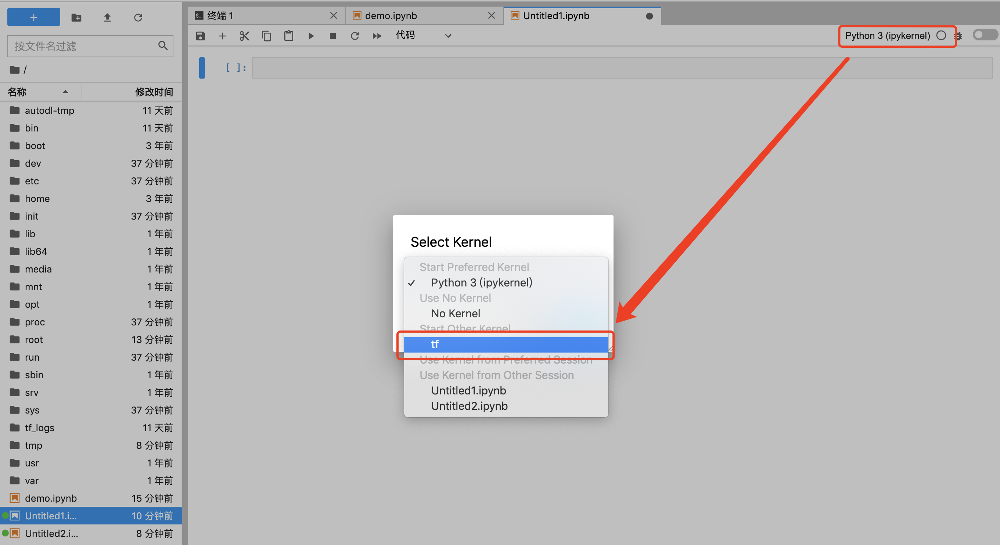

平台内置的所有镜像都安装了Miniconda，安装路径为/root/miniconda3/。

如果您需要使用其他版本的CUDA或cuDNN，那么可以通过Miniconda简单几步完成环境构建，推荐您租用实例时选择miniconda镜像（内部未安装任何深度学习框架，保持运行环境干净，避免不必要的问题）

以下以构建TensorFlow 1.15.0版本的运行环境为例进行说明如何使用Conda构建需要的环境。

<Tip>
  如果需要将虚拟环境安装在数据盘，请参考文档最下方的方法。
</Tip>


## 创建虚拟环境

```
conda create -n tf python=3.7           # 构建一个虚拟环境，名为：tf
conda init bash && source /root/.bashrc # 更新bashrc中的环境变量
conda activate tf                       # 切换到创建的虚拟环境：tf
```


## 安装软件依赖

这里以安装tensorflow==1.15.0为例

```
# 切换conda虚拟环境后
conda install tensorflow-gpu==1.15.0     # conda会自动解析依赖安装tensorflow 1.15.0版本需要的cuda和cudnn，无需自己独立安装

# 安装完使用Python进行简单的测试：
import tensorflow as tf 
hello = tf.constant('Hello, TensorFlow!') 
sess = tf.Session(config=tf.ConfigProto(log_device_placement=True))
print(sess.run(hello))
```


## Notebook环境切换

如何在JupyterLab的Notebook中使用新的Conda环境

```
# 创建Conda新的虚拟环境（如已创建，请忽略！）
conda create -n tf python=3.7             # 构建一个虚拟环境，名为：tf
conda init bash && source /root/.bashrc   # 更新bashrc中的环境变量

# 将新的Conda虚拟环境加入jupyterlab中
conda activate tf                         # 切换到创建的虚拟环境：tf
conda install ipykernel
ipython kernel install --user --name=tf   # 设置kernel，--user表示当前用户，tf为虚拟环境名称
```

执行以上命令后，如果创建新的Notebook，那么可以选择名为tf的Notebook



如果是已有的Notebook




## 清除Conda虚拟环境

```
# 清除安装的环境
conda deactivate          # 退出当前(tf)环境到base环境
conda remove -n tf --all  # 清除tf环境
```


## 删除安装包和缓存

```
conda clean -y --all
```


## 安装虚拟环境到数据盘
执行以下命令设置将虚拟环境安装到`/root/autodl-tmp/conda/envs`， 包缓存到`/root/autodl-tmp/conda/pkgs`
```
mkdir -p /root/autodl-tmp/conda/pkgs
conda config --add pkgs_dirs /root/autodl-tmp/conda/pkgs

mkdir -p /root/autodl-tmp/conda/envs
conda config --add envs_dirs /root/autodl-tmp/conda/envs
```

验证是否生效
```
# 执行命令查看配置的路径是否在文件内容中
cat /root/.condarc
```

**取消设置安装虚拟环境到数据盘**  
编辑/root/.condarc文件，删除对应的路径所在行即可
