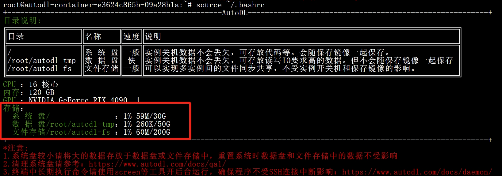
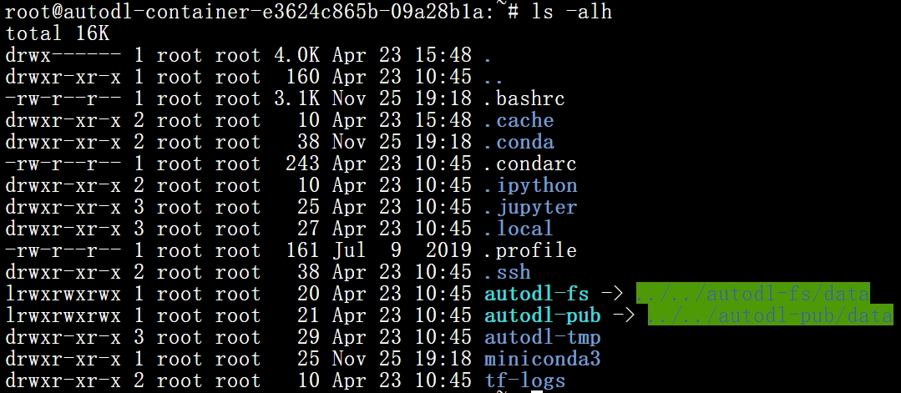
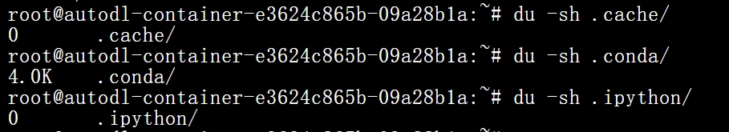
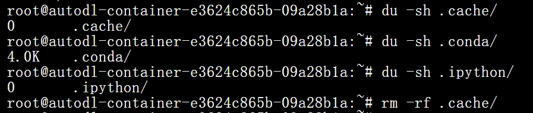
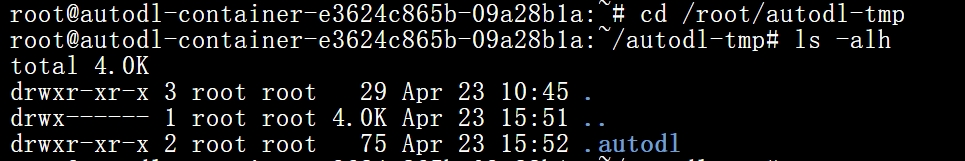

<Danger>
  注意使用rm命令删除文件无法恢复。
</Danger>

首先需要找到系统盘的空间被哪个目录占用了。如果不清楚什么是系统盘，请参考[帮助文档](/instance/configuration/env)

使用`source ~/.bashrc`可以查看系统盘和数据的使用情况。



以下两个是可以直接删除，不影响系统运行的目录，所以首先**直接删除**。如果未能释放空间，继续查看下文

```
du -sh /root/miniconda3/pkgs/ && rm -rf /root/miniconda3/pkgs/*      # conda的历史包
du -sh /root/.local/share/Trash && rm -rf /root/.local/share/Trash   # jupyterlab的回收站
```

以下目录是可能占用较大空间，但需要您根据实际情况清理的目录：

```
du -sh /tmp/         #查看/tmp占用的空间大小
du -sh /root/.cache  #查看/root/.cache占用的空间大小
```


## 正常清理步骤

首先查看文件和目录的使用空间，系统/根目录下的文件夹一般情况不会占用大的磁盘空间，因此可主要查看您创建的目录或文件等

### 文件大小

使用`ls -alh`命令来查看，比如下方的`.bashrc`、`.profile`文件的大小。但是**看到的文件夹大小仅仅是文件夹本身大小，并非文件夹下所有文件的大小**。



### 文件夹大小

使用`du -sh xxx`命令，递归统计该文件夹下所有文件的大小



### 删除

使用`rm -rf xxx`来删除文件/文件夹，释放空间



### 不占用系统盘空间的特殊文件夹

```
/root/autodl-tmp
/root/autodl-nas
/root/autodl-pub
/root/autodl-fs
```

## 数据盘清理

首先要进入数据盘`cd /root/autodl-tmp`，然后重复上述的清理步骤。



<Tip>
  数据盘一般是垃圾桶未清理导致磁盘占用，可以找/root/autodl-tmp/.Trash-0这个文件夹。确认文件不再需要后使用rm进行删除。
</Tip>

## 数据不想要了，全部清理

系统盘：在实例「更多」操作中，点击「重置系统」，系统盘将被清空恢复到镜像初始状态。请参考[文档](/instance/configuration/reset_instance)）

数据盘：执行`rm -rf /root/autodl-tmp/*`删除数据盘全部文件,注意无法清理隐藏文件（.xxx的文件）。
