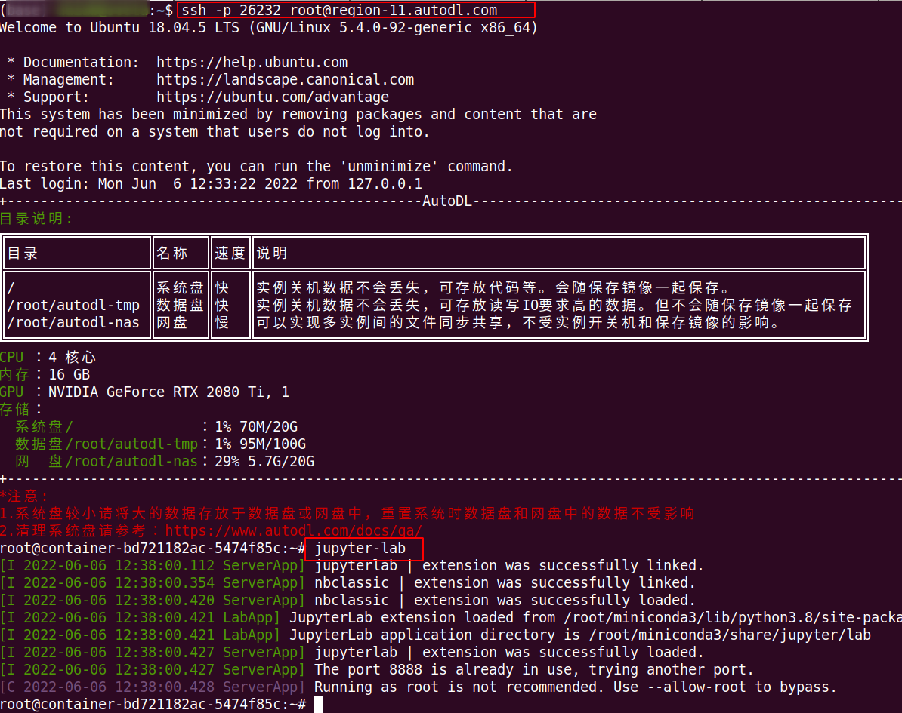
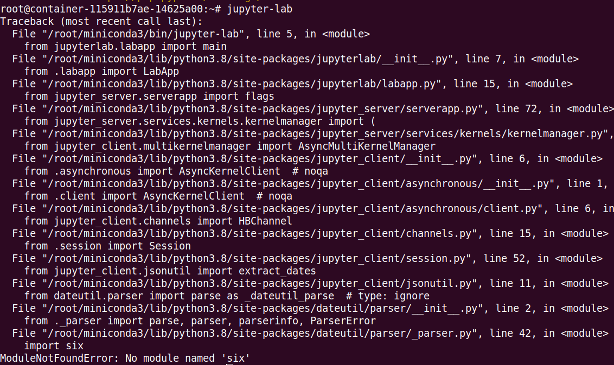
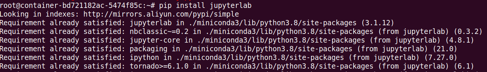
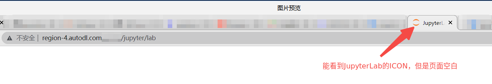
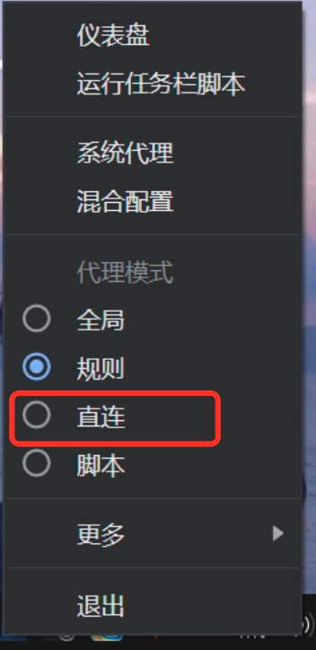
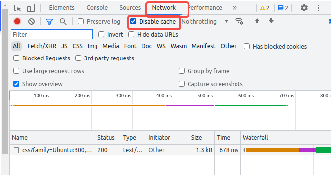

## 第1种原因

因为安装某些依赖导致JupyterLab的依赖被动升级或降级，从而影响了JupyterLab的运行，此时可以[SSH](/ssh)登录到实例，然后输入`jupyter-lab`命令进行确认，如果执行命令报错则说明是此问题，那么可以通过`pip install jupyterlab`再次安装后重启实例恢复。

（如果是windows用户，可以使用cmd或powershell进行ssh登录，**但是可能无法正常粘贴密码，需手动输入密码**）

<Frame>
  
</Frame>

输入jupyter-lab后看到以上输出则说明jupyterlab正常。如果发生以下类似报错，则jupyterlab无法启动

<Frame>
  
</Frame>

jupyter-lab发现启动报错，重装jupyterlab即可（如果pip命令不存在，那么先执行`conda install pip`，如果conda命令不存在，说明您可能删除了miniconda，最简单的解决方案是[重置系统](/reset_instance)）：

第一步卸载当前的jupyterlab：`pip uninstall jupyterlab`

第二步重新安装：`pip install jupyterlab`

<Frame>
  
</Frame>

## 第2种原因

排除第1种原因，其他大概率为网络问题，特别是挂了FQ的VPN，导致访问带端口的JupyterLab地址受限。

这种情况一般能看到网页上JupyterLab的ICON图标，但是页面无法加载显示空白

<Frame>
  
</Frame>

解决方法：

1. 关闭VPN，测试是否可以正常访问
2. 如果关闭了VPN，依然无法访问，那么需要打开VPN，将VPN的模式开为**直连模式**。VPN没有直连模式的，选择PAC模式，请勿选择全局模式（个别VPN即使关闭依然会对系统的网络造成影响），下图为Mac某款VPN和Windows某款VPN的设置：

<Frame>
  
</Frame>

<Frame>
  
</Frame>

3. 以上配置了VPN直连模式后，如果仍然无法打开，那么在JupyterLab网页按[F12] -> 选择Network -> 勾选Disable cache，勾选后刷新网页

   

4. 最后的绝招：更换浏览器。

## 第3种原因

部分校园网对访问端口有限制，如果您使用校园网，可以尝试切换非校园网使用，比如连接手机热点。

如果以上不能解决问题，请联系客服处理。
