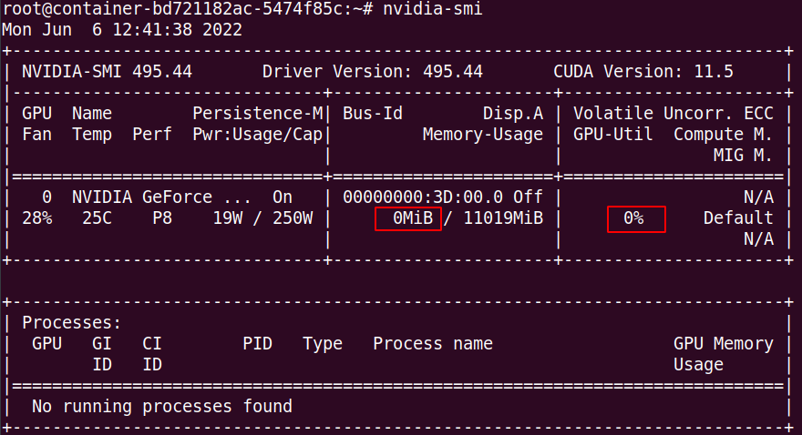
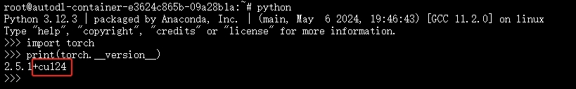

首先使用nvidia-smi命令检查GPU的使用情况

<Frame>
  
</Frame>

以上红色框标记的分别为显存占用和GPU使用率。如果程序开始运行后:

1. 显存无占用，那么可能是安装的框架为非GPU版本。检查方法为：

   ```
   # 如果你在用PyTorch
   # 如果版本号中带cu字样，说明是cuda版本，否则是cpu版本
   # 此外：使用Torch官方的conda安装命令在国内安装的一般为非cuda版本，而是cpu版本（有bug），因此推荐用pip安装，并且如果使用torch官方pip命令，去掉-f参数，这样可以走国内的pip源，速度更快
   import torch
   print(torch.__version__)  
   
   # 如果你在用TensorFlow 2.X版本
   import tensorflow as tf
   sys_details = tf.sysconfig.get_build_info()
   sys_details["cuda_version"]

   # 如果你在用TensorFlow 1.X版本
   import tensorflow as tf
   print("version:", tf.__version__)
   print("compiler_version:", tf.__compiler_version__)
   ```

下图为带cu字样的cuda版本示例。

<Frame>
  
</Frame>


2. 显存有占用，GPU占用率不为0，但是波动较大，此时正常使用了GPU，可以优化程序使GPU利用率更高，参考[帮助文档](/perf)

3. 显存有占用，但是GPU占用率一直为0。这种case可以分两种，一种安培架构的GPU（30系列的卡、A40、A100、A5000等）需要使用CUDA11.X。另一种case为代码未使用GPU，只不过import框架和构建网络时，框架会分配显存，因此看到的情况就是显存有占用，但是未使用GPU。这种情况可以通过其他代码进行验证：

   ```
   # 在终端执行以下命令，然后观察GPU的使用情况（注意该代码是Torch代码）
   # 如果GPU使用率不为0，则证明你的代码可能未调用GPU进行计算，请检查调试代码。如果以下代码执行异常，请联系客服协助处理
   wget http://autodl-public.ks3-cn-beijing.ksyun.com/debug/dp_res18.py
   python dp_res18.py
   ```

4. 如果以上代码执行无异常，但GPU仍没有占用，可以使用下面的代码进一步测试。

   ```
   # 如果用的PyTorch
   import torch
   print(torch.__version__)
   torch.rand(1, device="cuda:0")

   # 如果用的tf 2.x版本
   import tensorflow as tf
   with tf.device('/gpu:0'):
      a = tf.constant([1, 2, 3, 4, 5, 6], shape=[2, 3])
      b = tf.constant([7, 8, 9, 10, 11, 12], shape=[3, 2])
      c = tf.matmul(a, b)
      print(c)

   # 如果用的tf 1.x版本
   import tensorflow as tf
   gpu_options = tf.GPUOptions(per_process_gpu_memory_fraction=0.4,
                               allow_growth=True)
   config = tf.ConfigProto(gpu_options=gpu_options)
   
   with tf.device('/gpu:0'):
       a = tf.get_variable('var_a', initializer=tf.constant(15.0))
       b = tf.get_variable('var_b', initializer=tf.constant(25.0))
   
   with tf.device('/cpu:0'):
       c = a + b
   
   with tf.Session(config=config) as sess:
       sess.run(tf.global_variables_initializer())
       result = sess.run(c)
       print(f"\n计算结果: {result:.1f}")
   ```
   
   **报错1**：RuntimeError: CUDA error: no kernel image is available execution on the device
   说明此GPU需要使用更高CUDA版本的框架  <br />
   **报错2**：RuntimeError: The NVIDIA driver on your system is too old 
   说明使用的CUDA版本高于机器支持的CUDA版本，请使用高版本机器。<br />
   其他报错请联系客服协助处理。
   
