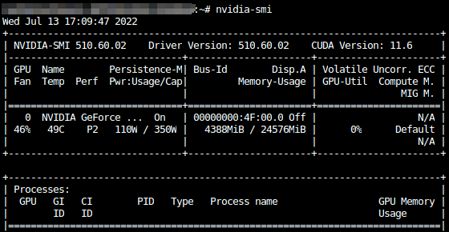
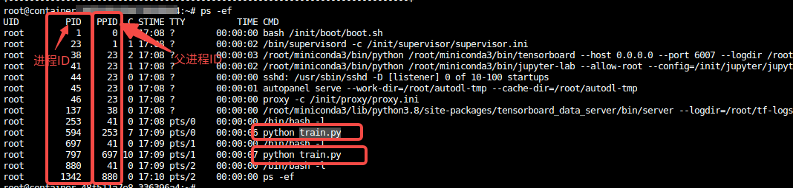
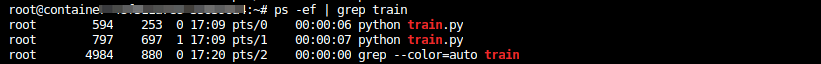
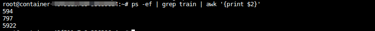
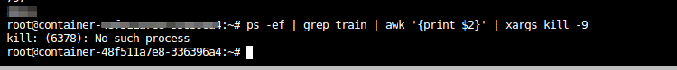
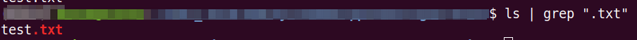

首先使用nvidia-smi命令检查GPU的使用情况，如果发现程序已经关闭了但是还有显存占用，说明有残留进程占用了显存，那么按以下方式释放：

<Frame>
  
</Frame>

从截图中能看出有程序占用了4388MiB的显存，此时要释放显存，那么首先找到进程ID：

使用`ps -ef`命令

<Frame>
  
</Frame>

可以看到PID、PPID、CMD 3列重要信息，分别是进程ID、父进程ID、进程的启动命令。

通过命令可以判断哪些进程是自己程序启动的进程，比如上方的`python train.py`就是我启动的进程，其他的均为系统进程或无关显存占用的进程。接下来杀死进程：

从截图中看到`python train.py`程序的进程ID是`594` 和`797`，那么可以使用**`kill -9 594 797`**命令来结束进程。 但是常常占用显存的进程会很多，特别是在多卡并行时，按此方法会比较繁琐，以下介绍一种更强大的方式结束进程：

通过`ps -ef`能看出，我自己的进程都包含了`train`关键字（并且其他无关的系统进程没有包含，防止误杀），那么使用`grep`命令可以过滤出我自己的进程，例如：

<Frame>
  
</Frame>

接下来是获取进程的ID，此时可以使用`awk`命令，`awk`命令用法复杂，这里简单记住以下命令即可：

<Frame>
  
</Frame>

最后再通过kill命令，即可完整的结束进程。完整命令为**`ps -ef | grep train | awk '{print $2}' | xargs kill -9`**

<Frame>
  
</Frame>

以上输出中会多出来一个`No such process`的错误，可以忽略，出现原因是`grep train`也会产生一个进程，被自己过滤出来。

### 更多说明：

Linux命令中的`|`符号称之为管道，作用是把前一个命令的输出作为下一个命令的输入（一般为stdout，stderr要做其他处理），管道的功能非常实用，在很多场景下都可以使用到，比如某个文件夹下有几万个文件，但是有一个文件是txt文件，其他均为图片，需要将此文件找出来。如果使用`ls`获取文件列表后人工排查非常麻烦，因此可以使用：

<Frame>
  
</Frame>
