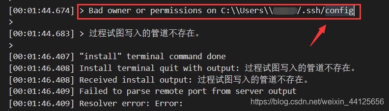
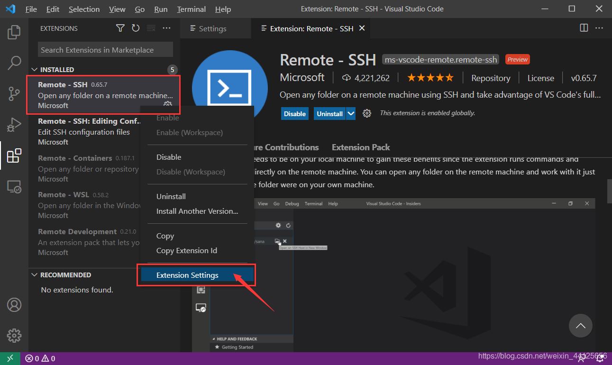
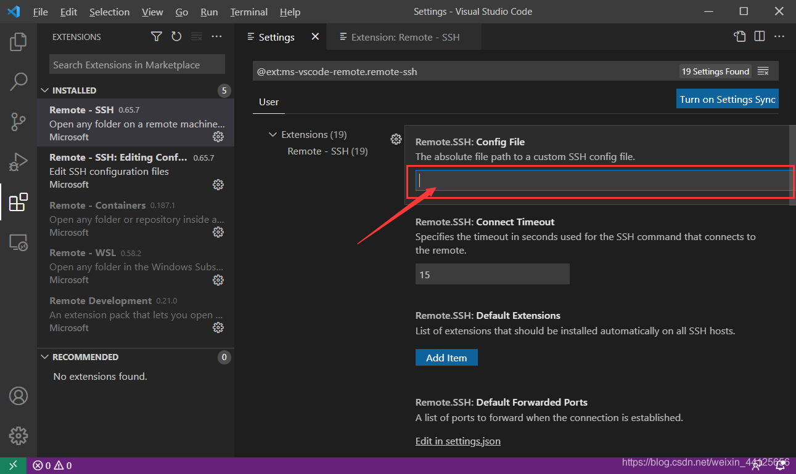

如果进行VSCode远程连接时在VS的输出中发现如下报错，那么可以参考下面的解决方法

<Frame>
  
</Frame>

## 解决方法

左侧栏打开Extentions，找到已经安装好的Remote -SSH，右键点击，选择“Extension Settings”

<Frame>
  
</Frame>

在Config File中输入报错的config文件路径

<Frame>
  
</Frame>

然后重新尝试连接，观察是否可以解决该问题
