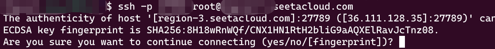
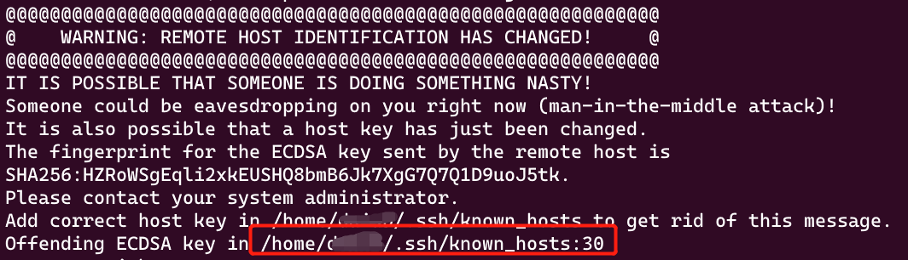

1. 如果您使用VSCode、PyCharm等基于SSH的连接异常时，请按下面的方式排查解决
2. 如果您在使用XShell、MobaXterm连接异常，请参考[文档](/xshell)，无需继续看下面的解决方法

## 排查与解决

可能原因：

1. 如果实例的系统盘重置或更换镜像，那么SSH的指纹会发生变化，于是SSH时会报错`REMOTE HOST IDENTIFICATION HAS CHANGED`
2. 如果本地ssh config文件权限不对，会由于ssh时无法写入配置报错（也有可能是其他文件）
3. VSCode由于连接同一个host（不同端口）的地址时，写入的config信息无法区分不同的实例地址，导致错误连接而失败

排查方法：

**Step.1** 先排查前两种原因，如果是Windows客户启动栏里搜索`powershell`，如果是Mac用户搜索`terminal`，使用powershell/terminal输入实例的完整SSH指令后回车，如果是连接正常，那么会出现如下信息：

<Frame>
  
</Frame>

以上均可验证为连接正常，无需进行下一步输入密码。此时您可以查看Step2排查VSCode/PyCharm等原因。如果出现以下错误信息并退出ssh：

<Frame>
  
</Frame>

以及上述的错误信息可能还有：

```
Bad owner or permissions on C:\Users\USER\.ssh\config
和
Load key "C:\Users\USER\.ssh\id_rsa": bad permissions
```

此时解决方法为：删除报错信息中的`known_hosts`、`config`文件（本地文件，每个人看到的路径可能不同），如果是rsa密钥的权限错误，Windows用户请修改密钥的权限为只读，Linux/Mac 执行`chmod 600 rsa文件`

**Step.2**

**VSCode连接异常**

一般原因为HOST冲突，比如此类情形: 在同一个地区租用了A和B两个实例，由于A和B只是HOST名称相同端口不同，于是VSCode在ssh/config文件中写入的配置信息HOST别名一模一样，当A关机而B实例开机时，连接B实例会导致VSCode错误连接A，导致连接失败。这种情形简单暴力的做法是删除`C:\Users\USER\.ssh\config`文件，优雅的方式是编辑该config文件，将里边Host字段的名称（主机的别名）进行修改后重新连接

**PyCharm连接异常**

由于PyCharm封装复杂，并且外面看不到更多日志，需根据报错信息进行排查
