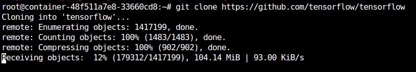
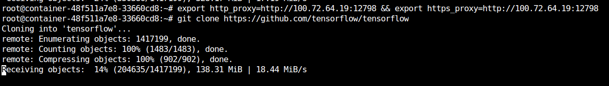

## 公开服务
点击访问网址，站点内有具体教程。

Github： <a href="https://ghproxy.link/" target="_blank">https://ghproxy.link/</a>  （点击后查看当前可用的域名地址，然后点击地址跳转查看文档）

HuggingFace镜像站：<a href="https://hf-mirror.com/" target="_blank">https://hf-mirror.com/</a>


## AutoDL内置服务

<Warning>
  声明：限于学术使用github和huggingface网络速度慢的问题，以下为方便用户学术用途使用相关资源提供的加速代理，不承诺稳定性保证。此外如遭遇恶意攻击等，将随时停止该加速服务
</Warning>

以下为可以加速访问的学术资源地址：

- github.com
- githubusercontent.com
- githubassets.com
- huggingface.co

如果在终端中使用：

```
source /etc/network_turbo
```

如果是在Notebook中使用：

```
import subprocess
import os

result = subprocess.run('bash -c "source /etc/network_turbo && env | grep proxy"', shell=True, capture_output=True, text=True)
output = result.stdout
for line in output.splitlines():
    if '=' in line:
        var, value = line.split('=', 1)
        os.environ[var] = value
```

**取消学术加速**，如果不再需要建议关闭学术加速，因为该加速可能对正常网络造成一定影响。

```
unset http_proxy && unset https_proxy
```

### 速度对比

未使用加速：



使用加速：


