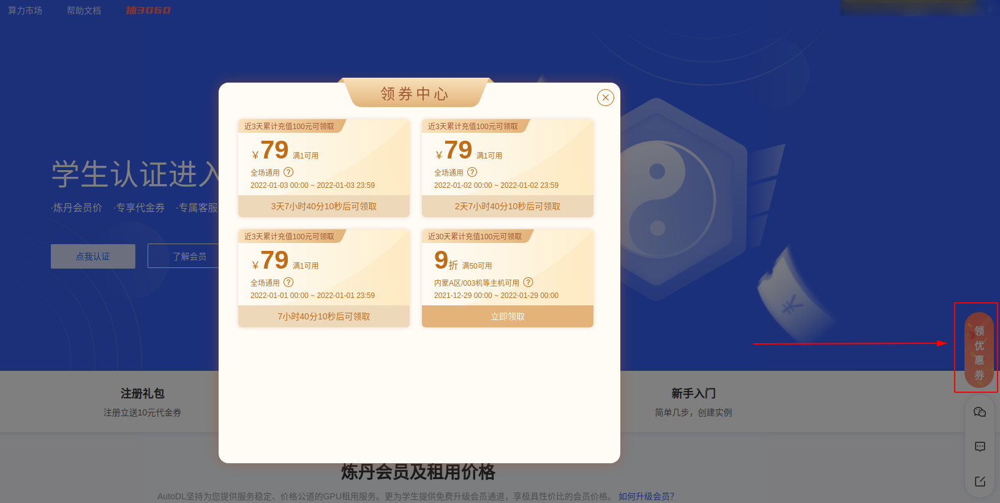
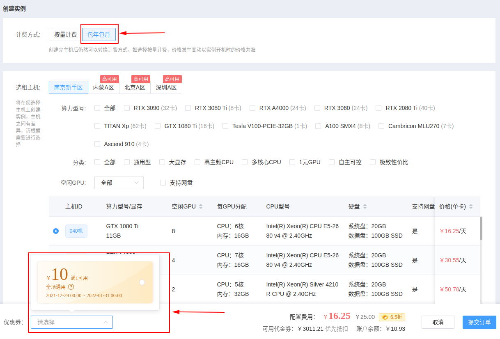

## 领取

入口在首页右侧 -> 领优惠券

在领取优惠券时请确认优惠券的使用范围，一般有：全场通用、部分地区可用、部分主机可用，选择适用于自己的优惠券进行领取。

<Frame>
  
</Frame>

## 使用

满减和折扣优惠券都仅能用于包年包月（在新租包年包月实例、按量计费转包年包月、包年包月续费时可用），如果您当前是按量计费想使用优惠券，那么可以在转包年包月时使用，最后在包年包月到期前转回按量计费。

优惠券一般设置有最高减免金额，比如：单卡1日费用。举个例子：如果有一张每满100减10的优惠券，您准备租用5卡TITAN Xp 10日，价格为10元/日/卡，那么总费用为500元，按照满减规则应该减50元，如果该优惠券有最大减免单卡1日费用，那么实际优惠金额为10元。

使用优惠券，以新租实例为例：

<Frame>
  
</Frame>
