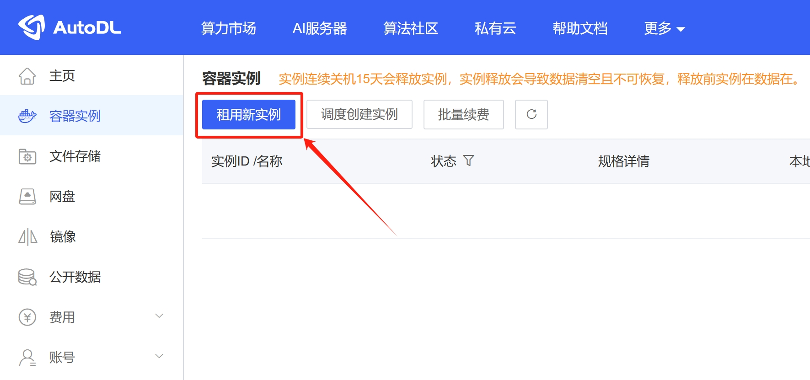
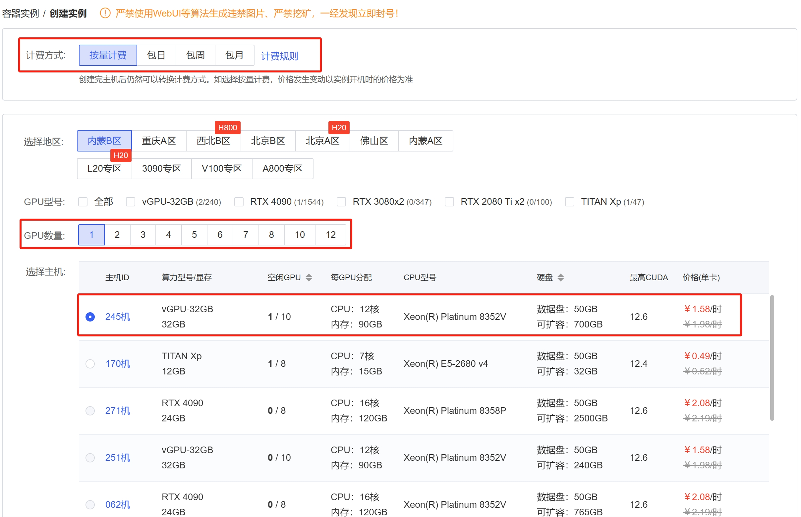
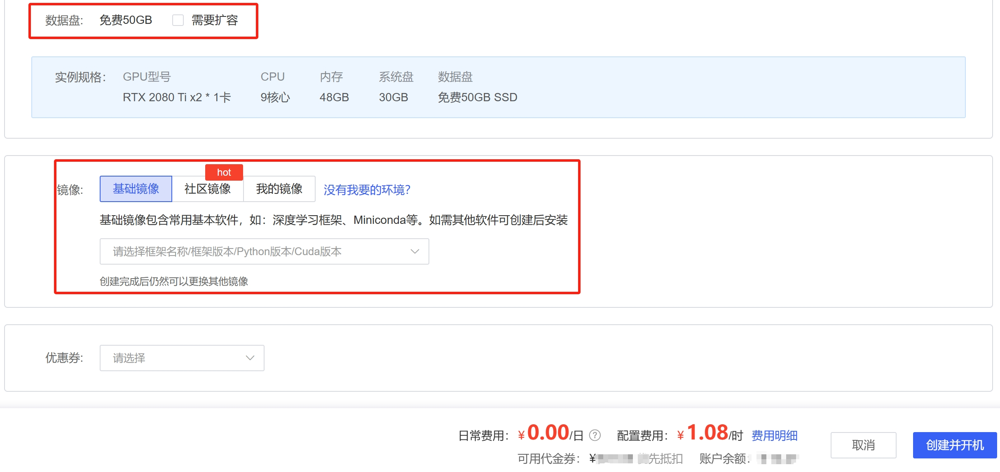
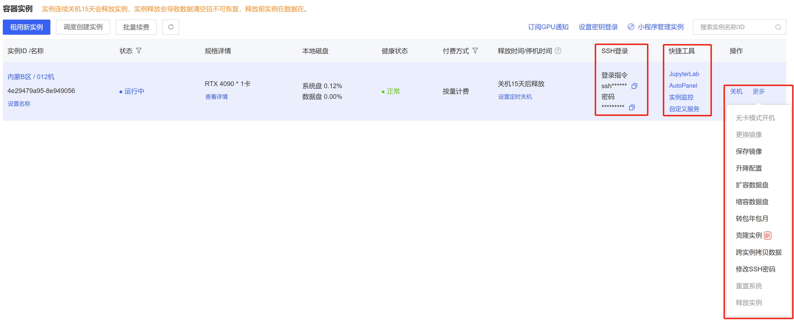
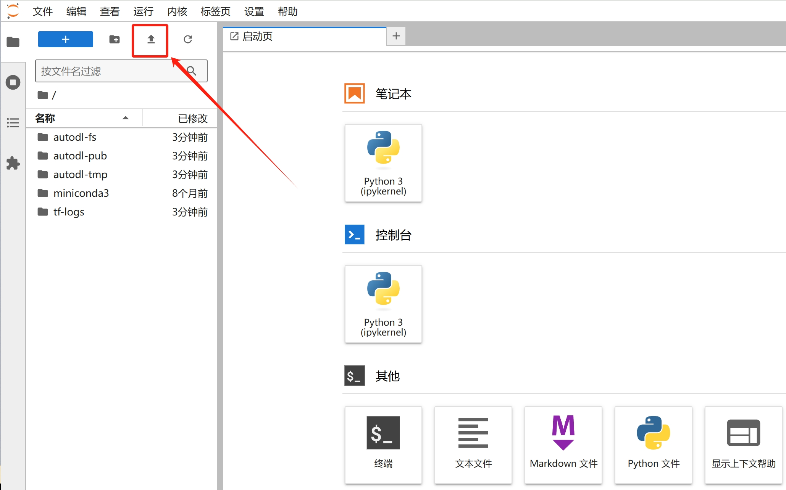
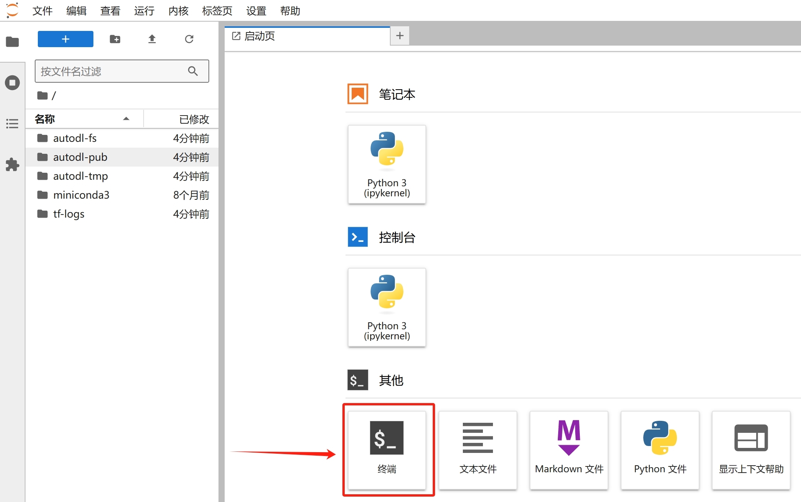
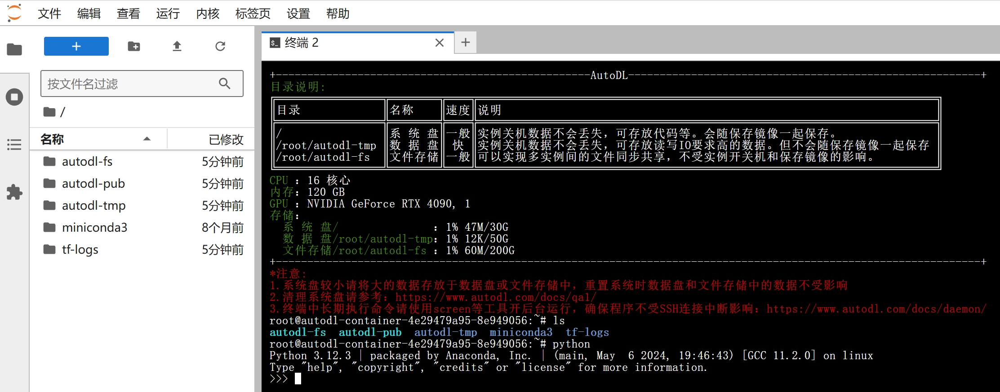

> AutoDL实例中的数据（包括环境）在关机后将全部保存，开机后无需再次配置和上传数据。总而言之，实例在数据在，但是连续关机15天实例将被释放。详见[实例数据保留说明](/instance_data)。

## 创建实例

注册后进入控制台，在我的实例菜单下，点击「租用新实例」。

<Frame>
  
</Frame>

在租用实例页面：选择**计费方式**、**地区**、**GPU型号**、**GPU数量**，然后选择合适的**空闲主机**和**镜像**（内置了不同的深度学习框架的基础镜像和社区镜像），最后创建即可。

> 如果你需要更大的硬盘用于存放数据，那么请留意「硬盘」这列「可扩容」大小。数据盘的路径请参考[文档](/env)。

创建完成后等待自动开机，今后主要用到的操作入口见截图中。

> 请注意实例状态显示「运行中」开始计费，如不使用请及时关机停止计费。计费规则详见[计费说明](/price)。

<Frame>
  
</Frame>

## 上传数据

开机后在这个正在运行中的实例上找到快捷工具：「JupyterLab」，点击打开，在下面的截图中找到上传按钮，即可上传数据。如需上传文件夹或更高级的上传方式等，请查阅[上传数据文档](/scp)

<Frame>
  
</Frame>

## 终端训练

在打开的JupyterLab页面中打开终端。如需使用其他IDE远程开发，请参考[VSCode(推荐)](/vscode)和[PyCharm](/pycharm)

<Frame>
  
</Frame>

在终端中执行您的Python命令等完成训练

<Frame>
  
</Frame>

## 进阶

1. [如何选择GPU](/gpu)
2. [配置环境](/base_config)
3. [FileZilla上传数据](/filezilla)
4. [公网网盘(强烈推荐)](/netdisk)
5. [VSCode](/vscode)
6. [PyCharm](/pycharm)
7. [开守护进程](/daemon)
8. [Git克隆代码](/git)
9.  [Linux基础](/linux)
10. [常见问题](/qa)

 
