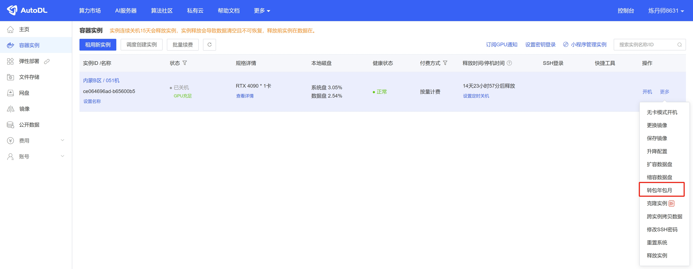
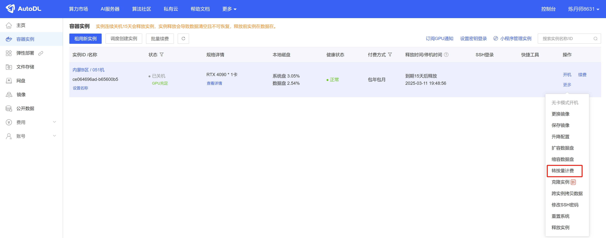
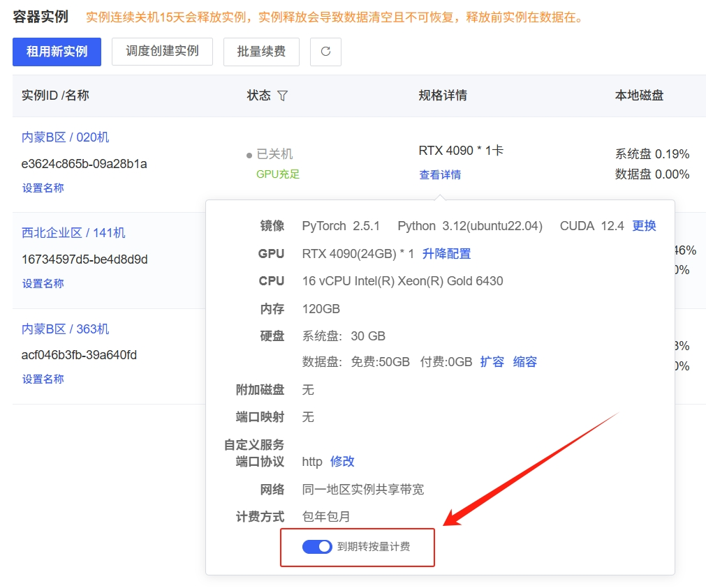

容器实例**按量计费**和**包年包月**两种计费方式支持互转，转换入口为在实例列表最后一列的「更多」操作中点击「转按量计费」或「转包年包月」。如果包年包月转按量计费则会退款，退款规则为计算包年包月期间已消费的费用，单价根据已使用时长来确定，比如包了1月仅使用8天后转按量计费那么会以包周（使用超过7天）的价格来计算已消费金额，那么这里已消费金额即为：周单价x(8天/7)，然后在扣除已消费金额时优先使用已支付的代金券，未能完全抵扣的再使用已支付的余额部分，最后未消费的余额部分退款。注意如果代金券抵扣后还有剩余不再退还代金券。从退款规则看，**最经济**的使用方式是：包年包月，然后如果不再使用后转按量退款处理，这样会按照更经济的单价计费。

更多具体计费规则参考[文档](/price)

<Frame>
  
</Frame>

<Frame>
  
</Frame>

如果包年包月实例需要到期后不关机自动转按量计费，可以在「控制台」->「容器实例」->「查看详情」下面**开启**「到期转按量计费」。

<Frame>
  
</Frame>
