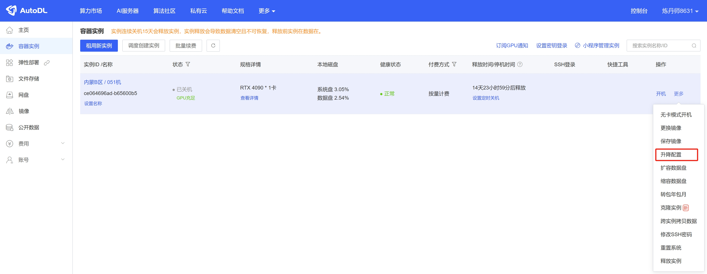
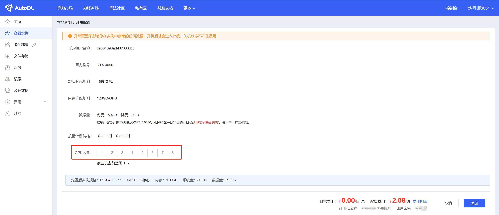
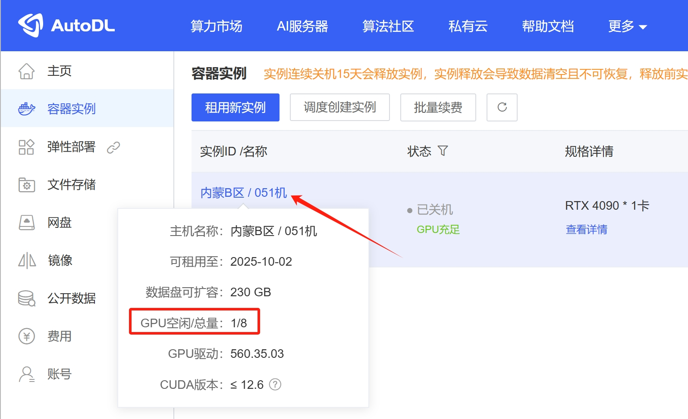

对于已经开机的按量计费的实例，如果需要增加或减少GPU的数量，那么可以使用升降配置功能调整实例的配置。对于包年包月的实例如果想要升降配置，则需要先转按量计费后升降配置。

**Step.1**

将实例关机，然后从`更多`里找到`升降配置`按钮，点击进入升降配置页面

**Step.2**

选择GPU数量，此时CPU和内存会根据GPU数量，相应进行调整。最终实例的规格，可以参考下方`变更后实例规格`。

**升级配置小技巧**

控制台 -> 容器实例，点击第一列实例名称，即可查看当前主机GPU空闲情况，以此可以判断该主机是否可以继续升级配置。如果当前主机空闲GPU不满足您的升级要求，可以选择迁移到其他满足需求的主机。[迁移实例（同地区）](/migrate_instance_2)

