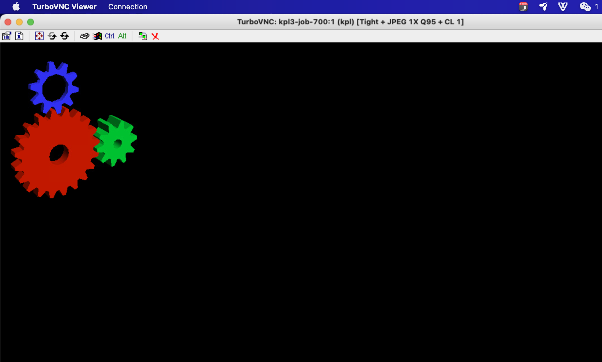

<Tip>
  由于远程桌面的配置繁琐以及体验一般，如果您不是强需求，推荐您对代码做相应调整(比如opencv的imshow改为imsave保存图片后浏览)
</Tip>

VNC（Virtual Network Computing ）是一种图形化的桌面共享协议，它使用远程帧缓冲协议 (RFB) 来远程控制另一台计算机，它将键盘和鼠标事件从一台计算机传输到另一台计算机，通过网络向另一个方向转发图形屏幕更新。
对于一般性的GUI程序运行需求，我们其实可以借助VNC在不安装完整桌面环境的情况下方便快捷的实现，下面介绍如何借助turbovnc工具，在实例中运行一个GUI程序并在本地电脑进行显示：

**Step.1**  

安装VNC和必要的一些图形显式库:

```
# 安装基本的依赖包
apt update && apt install -y libglu1-mesa-dev mesa-utils xterm xauth x11-xkb-utils xfonts-base xkb-data libxtst6 libxv1

# 安装libjpeg-turbo和turbovnc
export TURBOVNC_VERSION=2.2.5
export LIBJPEG_VERSION=2.0.90
wget https://autodl-public.ks3-cn-beijing.ksyuncs.com/tool/vnc/libjpeg-turbo-official_${LIBJPEG_VERSION}_amd64.deb
wget https://autodl-public.ks3-cn-beijing.ksyuncs.com/tool/vnc/turbovnc_${TURBOVNC_VERSION}_amd64.deb
dpkg -i libjpeg-turbo-official_${LIBJPEG_VERSION}_amd64.deb
dpkg -i turbovnc_${TURBOVNC_VERSION}_amd64.deb
rm -rf *.deb

# 启动VNC服务端，这一步可能涉及vnc密码配置（注意不是实例的账户密码）。另外如果出现报错xauth未找到，那么使用apt install xauth再安装一次
rm -rf /tmp/.X1*  # 如果再次启动，删除上一次的临时文件，否则无法正常启动
USER=root /opt/TurboVNC/bin/vncserver :1 -desktop X -auth /root/.Xauthority -geometry 1920x1080 -depth 24 -rfbwait 120000 -rfbauth /root/.vnc/passwd -fp /usr/share/fonts/X11/misc/,/usr/share/fonts -rfbport 6006

# 检查是否启动，如果有vncserver的进程，证明已经启动
ps -ef | grep vnc
```

**Step.2**

以上启动Server时，手动设置了rfbport=6006端口，下面通过SSH隧道将实例中的6006端口代理到本地：[SSH隧道](/best_practices/remote/ssh_proxy)

完成上述步骤后使用vnc客户端连接，地址请填写：`127.0.0.1:6006`

在您的local电脑使用turbovnc客户端进行连接，地址为上述获取的地址，一切顺利的话，输入密码就能看到VNC连接成功后的图形化界面，以及正在运行在实例中的GUI程序；另外这里提供不同系统turbovnc客户端的下载链接（也可以到turbovnc官网下载）

Ubuntu: https://autodl-public.ks3-cn-beijing.ksyuncs.com/tool/vnc/turbovnc_2.2.5_amd64.deb  
MacOS: https://autodl-public.ks3-cn-beijing.ksyuncs.com/tool/vnc/TurboVNC-2.2.5.dmg  
Windows: https://autodl-public.ks3-cn-beijing.ksyuncs.com/tool/vnc/TurboVNC-2.2.5-x64.exe   



**Step.3**

在终端中添加环境变量：`export DISPLAY=:1`，然后再执行您的命令（注意在同一终端执行）

可以使用以下python代码进行简单验证：

```
import numpy as np
import cv2

h = 500
w = 500
img = 255 * np.ones((h ,w , 3), dtype=np.uint8)
cv2.imshow("", img)
cv2.waitKey(0)
```

如果在本地的vnc client显示图片，证明安装和启动过程无误
