<Note>
  JupyterLab的工作目录为`/root`目录，而非`/`系统根目录。如需查看根目录`/`，可以进入终端使用命令行操作。
</Note>

## 基本功能介绍
进入jupyterlab，「控制台」->「容器实例」->「Jupyterlab」

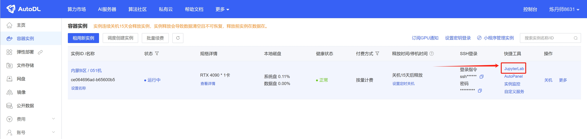

JupyterLab界面说明

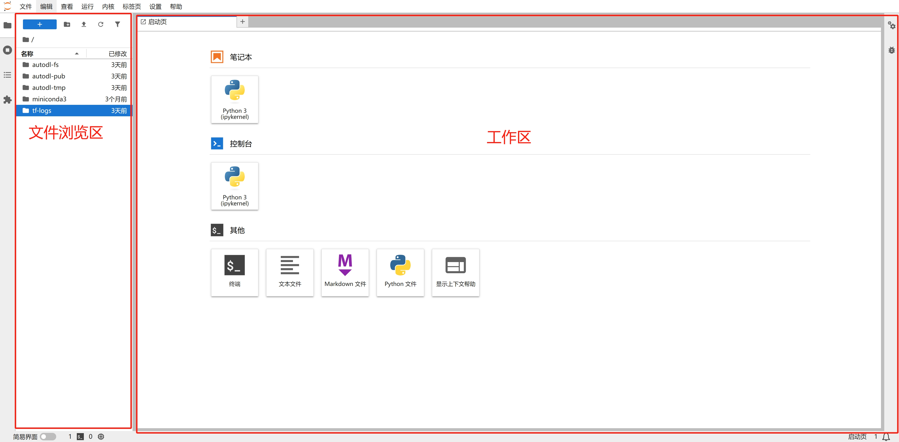

上传文件

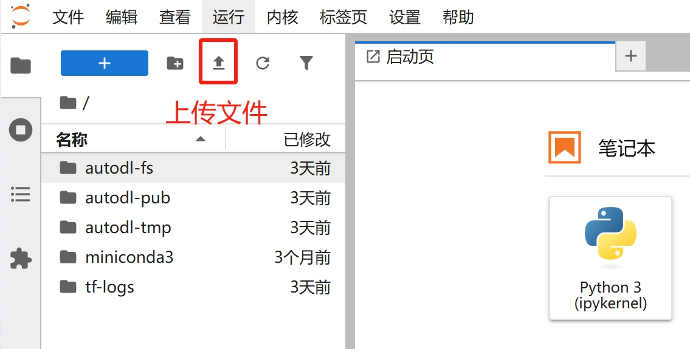

使用Notebook

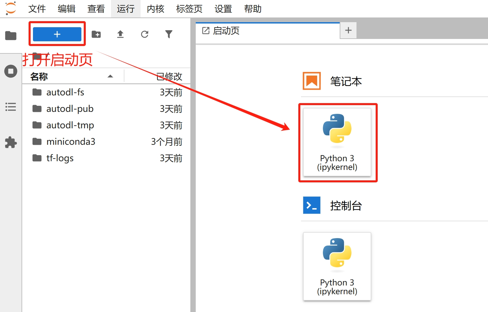

打开新终端

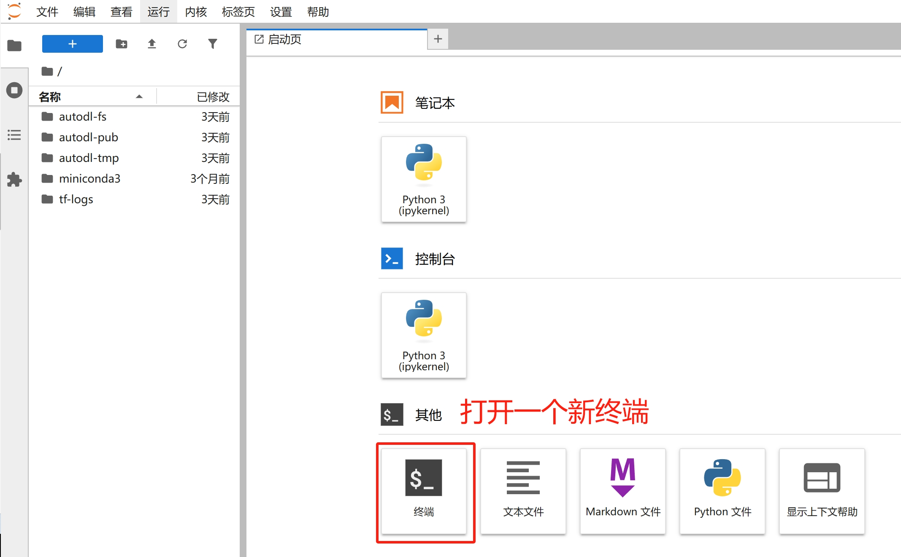

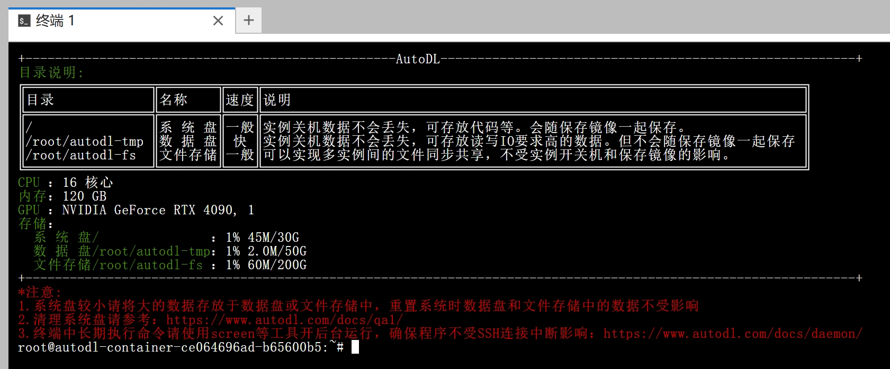

访问打开的终端或Notebook（JupyterLab在关闭终端/Notebook选项卡后默认不会终止，仍然在运行）

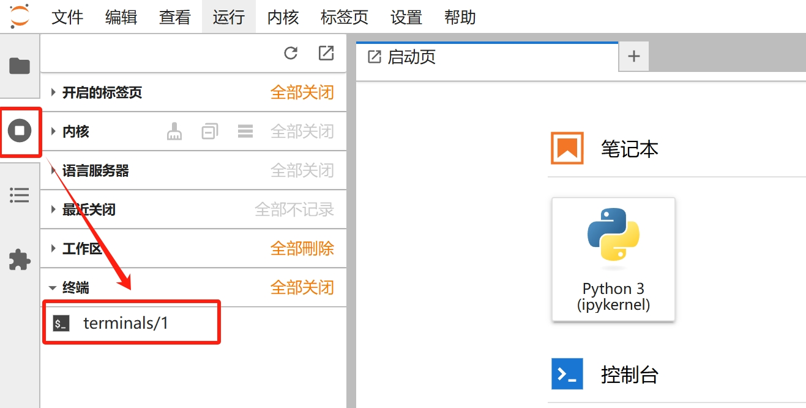

文件管理

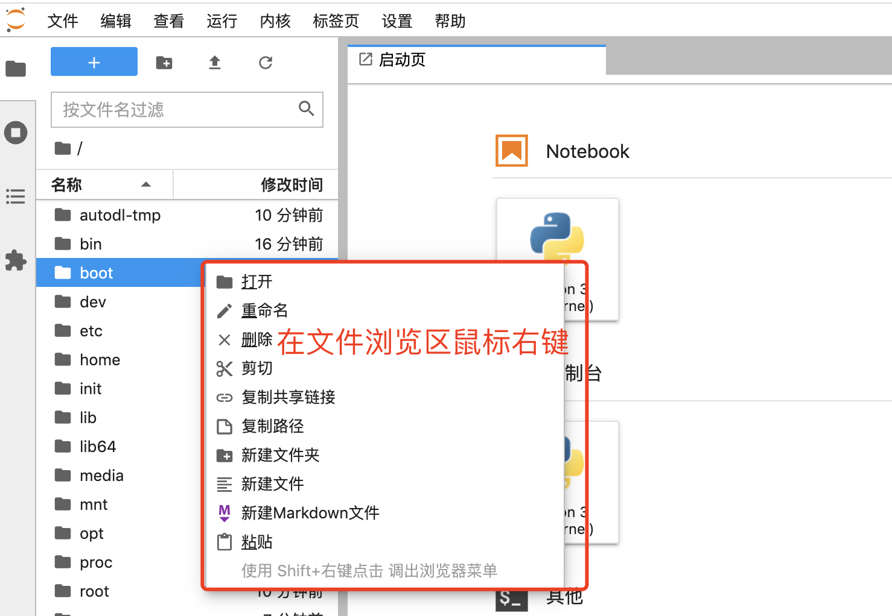

## 附：使用常见问题

如果用Notebook跑程序的同学会发现，隔了一段时间Notebook的日志不更新了。此时可以使用「日志控制台」的功能查看日志，演示一遍过程：

如下一段程序执行起来后，刷新网页此时会发现日志不再更新

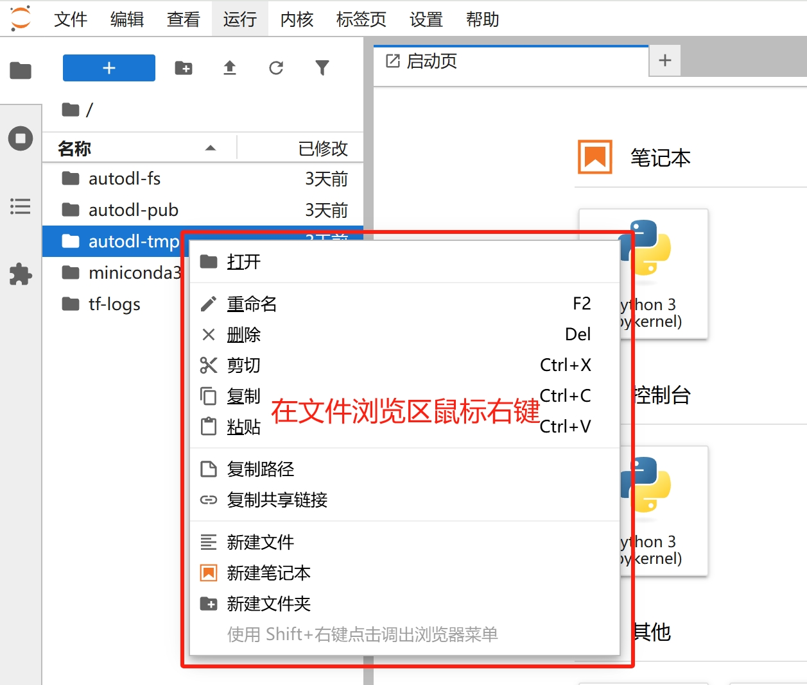

打开日志控制台：

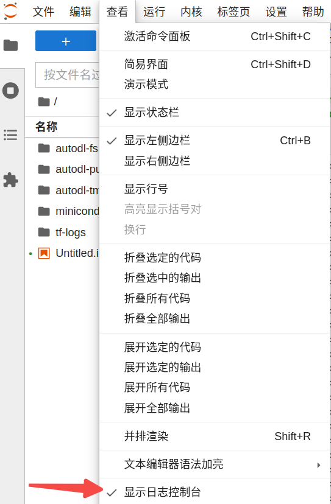

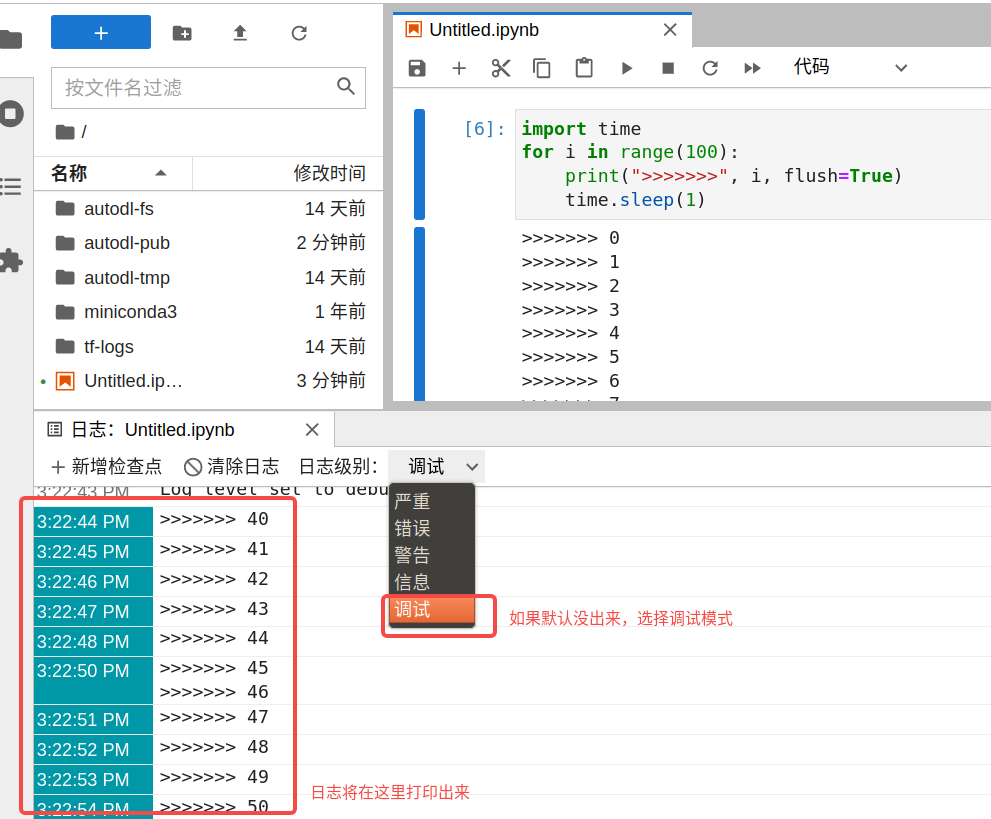
