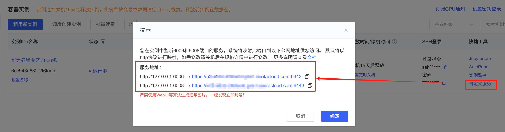

<Note>
  注意：开放端口需要进行企业认证，认证入口在「控制台」→「账号」→「账号安全」，如果您是个人用户可选择使用[SSH隧道工具](/best_practices/remote/ssh_proxy)代理任意端口到本地访问
</Note>

由于实例无独立公网IP，因此不能开放任意端口。但是AutoDL为每个实例的`6006和6008`端口都映射了一个可公网访问的地址，也就是将实例中的`6006和6008`端口映射到公网可供访问的`ip:port`上，映射的协议支持TCP或HTTP，协议可自行选择，`ip:port`可在「自定义服务」入口获取：

点击复制可以获取到该地址，例如：`https://u39-b3fb-39a640fd.nmb2.seetacloud.com:8443`。`u39-b3fb-39a640fd.nmb2.seetacloud.com`和`8443`分别就是地址和端口

关于该功能的用法举例可以参考：[Visdom](/best_practices/tools/visdom)
