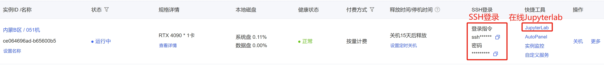
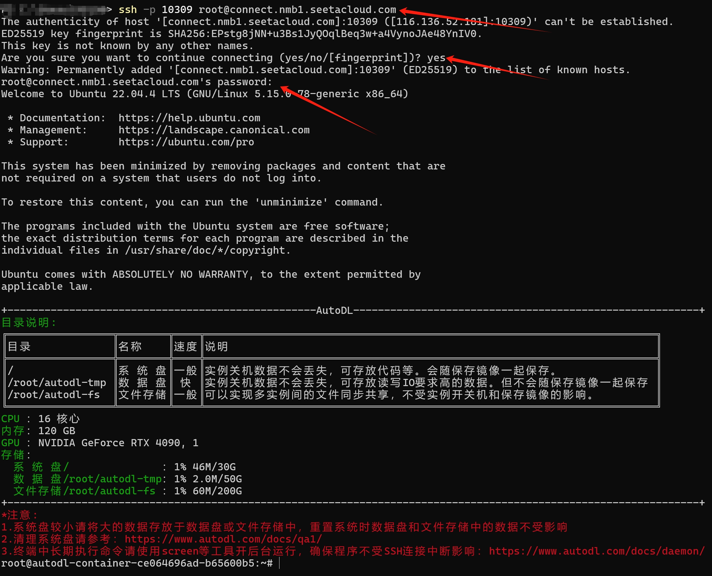
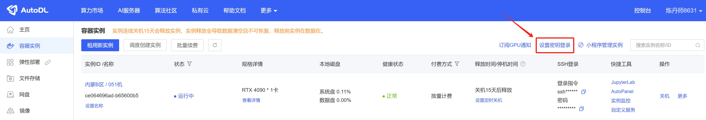
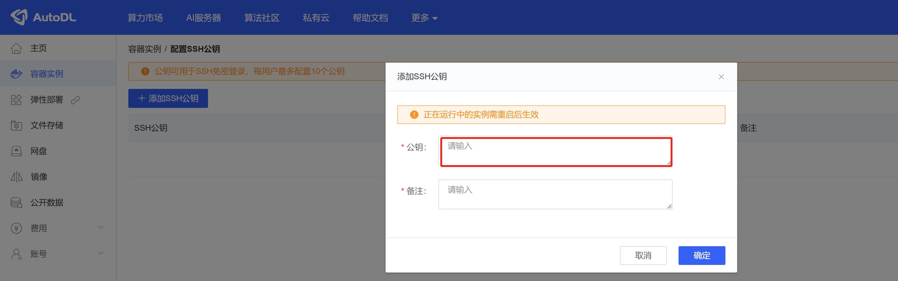
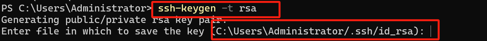

<Tip>
  如果您是Windows用户，可以使用系统自带的Powershell/CMD登录，如果要更好的终端体验推荐下载使用[Cmder](http://autodl-public.ks3-cn-beijing.ksyun.com/tool/cmder_mini.zip)工具，免安装解压即用。或者使用[XShell工具](/best_practices/remote/xshell)更佳。

  如果是Mac用户，可以使用系统自带的Terminal完成SSH登录。
</Tip>

## SSH登录

开机实例后，找到SSH登录指令



复制您的SSH登录指令，这里演示使用的是：`ssh -p 10309 root@connect.nmb1.seetacloud.com` 

<Note>
  在`ssh -p 10309 root@connect.nmb1.seetacloud.com`命令中， 各个参数的含义为：

  用户名：root

  主机host： connect.nmb1.seetacloud.com

  端口号：10309
</Note>

在您的本地终端中输入该命令，输入密码进行登录。（**注意：密码不会显示任何字符，正确输入或鼠标右击粘贴后回车即可**）



<Warning>
如果通过SSH登录后执行训练程序，请使用screen/tmux开守护进程，确保程序不受SSH连接中断影响程序执行！ screen使用方法详见[守护进程](/instance/execution/daemon)。
</Warning>

## SSH免密登录

从「控制台」->「容器实例」->「设置密钥登录」入口进去配置SSH公钥。这样重启后或新创建的实例都能免密码登录，减少复制SSH登录密码的麻烦。密钥/公钥生成方法请看文末





**生成RSA密钥对**

Linux/Mac用户：

```bash
# 打开Terminal终端，执行命令然后回车即可：
ssh-keygen -t rsa
```

Windows用户：

```bash
# 打开Powershell终端，执行命令然后回车即可：
ssh-keygen -t rsa
# 老版本Win报错没有ssh-keygen命令，那么需要安装Git bash后使用Git bash终端执行上面的命令生成
```

生成过程：

生成的路径Win在`C:\Users\{用户名}\.ssh\`，Linux/Mac在：`/home/{用户名}/.ssh/`



生成后有两个文件`id_rsa`和`id_rsa.pub`，前者为私钥（不要泄露），后者为公钥。配置免密即为将公钥内容**完整全部**复制粘贴到AutoDL公钥表单中
