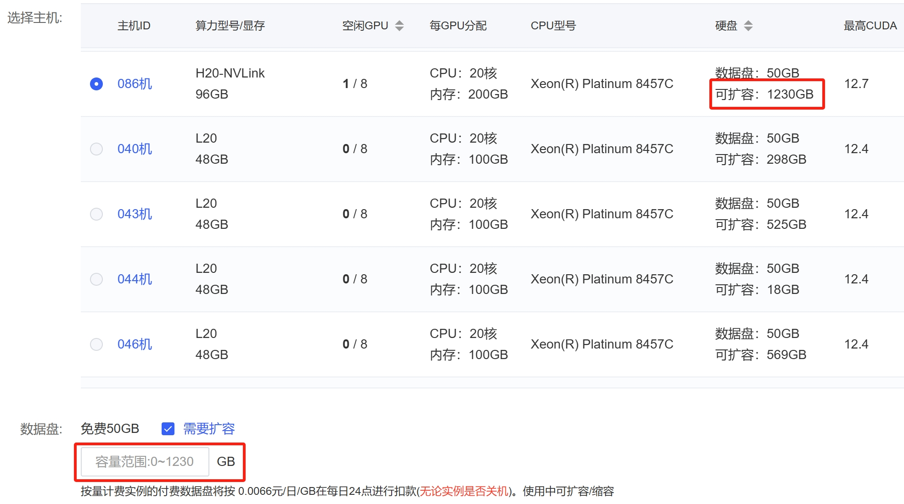
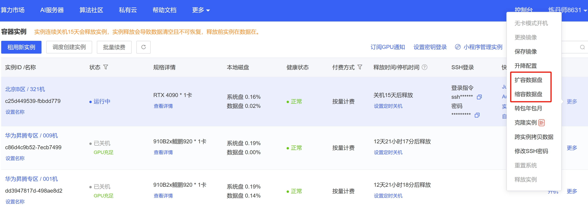

<Warning>
  实例的系统盘与数据盘一般为本地SSD磁盘，少量为云盘，本地数据盘性能好但是无冗余副本，受限于本地磁盘的固有寿命，有概率出现故障，重要的数据请定期备份到[文件存储](/instance/data-storage/fs)或本地，AutoDL对于此类本地存储产品不提供可靠性承诺与服务。
</Warning>

默认租用实例时，主机都会提供免费50GB大小的数据盘。如果您需要扩容数据盘那么请在租用时选择可扩容对应容量的主机：

在租用后也可以进行扩容和缩容操作：

数据盘的计费方式为：

1. 对于按量计费实例，会以当天使用的最高容量（如果有缩容）在23:59:59计费，无论该实例在当天是否关机，直到实例释放或缩容所有的付费数据盘为0GB。价格约为 0.0066元/日/GB（会员价格），以实际网站显示的价格为准。
2. 对于包年包月实例，租用时会按选择的数据盘大小计算需要支付的费用，你可以在租用页面最下方费用明细查看数据盘的具体支付金额。如果包年包月实例到期后，实例还有付费数据盘，那么会和按量计费实例一样的规则对数据盘进行计费，无论是否关机，直到实例释放或缩容所有的付费数据盘为0GB。
