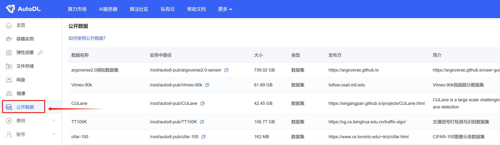
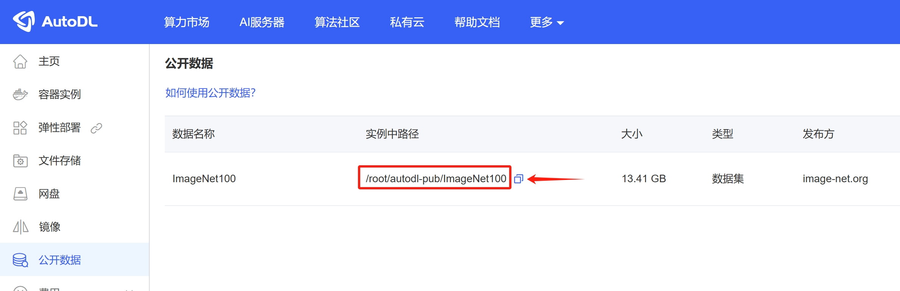
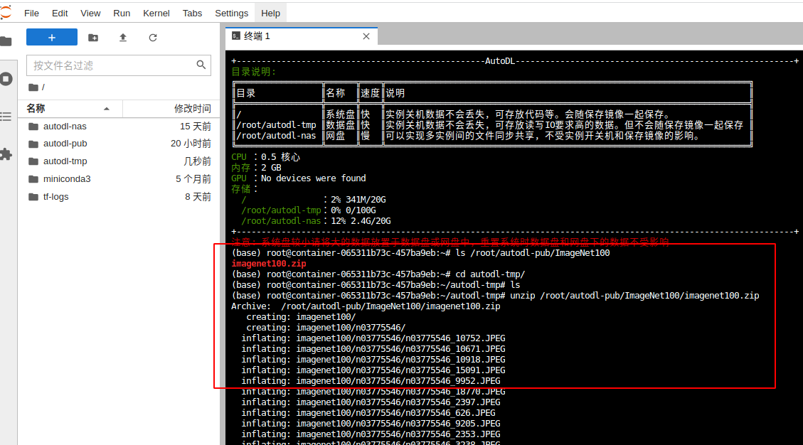

AutoDL提供了部分常用开源数据，供您在实例中进行使用，免去下载上传的烦恼。

在控制台中找到公开数据菜单：

<Frame>
  
</Frame>

搜索数据集的名称，如果找到的话则进行下一步：

复制数据在实例中的路径，然后在您的实例中找到该数据集

<Frame>
  
</Frame>

在实例中找到该数据集，然后解压到自己的数据盘中（/root/autodl-tmp）

> 注意以下截图中的解压命令unzip仅适用zip压缩包，如果是其他压缩包请用相应命令解压。[可以参考](/linux)

<Frame>
  
</Frame>
