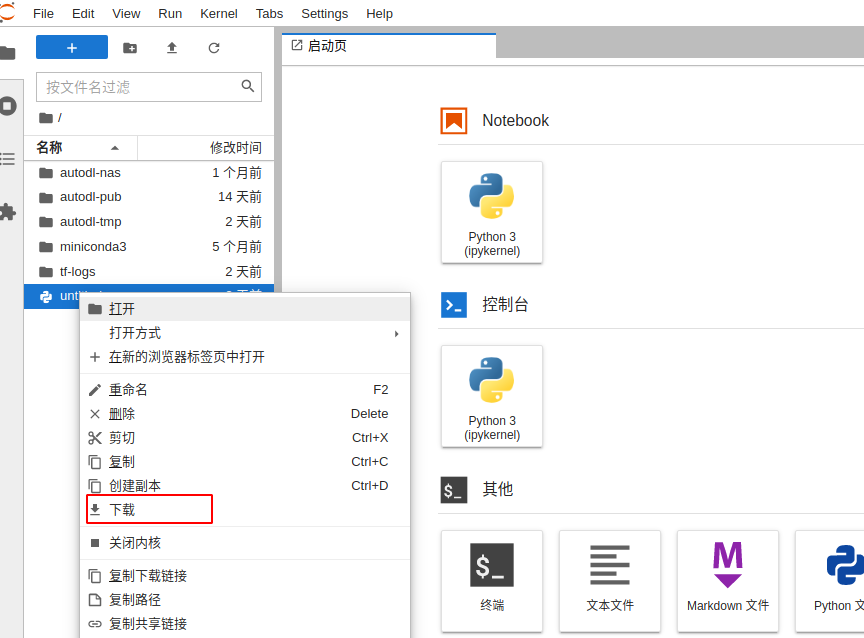
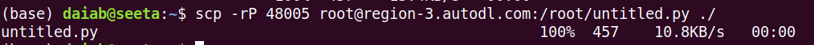

1. [JupyterLab](/jupyterlab)可以下载文件，但是不能下载文件夹，好处是简单易用。
2. [公网网盘(强烈推荐)](/netdisk)，直接使用阿里云盘、夸克网盘、百度网盘、OSS上传下载数据。
3. scp命令支持文件和文件夹，由于是命令行执行，上手难度稍高。
4. [FileZilla](/filezilla)软件支持文件和文件夹，拖拉拽即可上传下载，**推荐使用**。

## Jupyterlab

选中文件，然后鼠标右键，菜单中选择下载。

<Frame>
  
</Frame>

# scp命令

> ⚠️下方指令需要在您**本地**的机器上执行，而不是在实例中执行该命令;
> 
> 如果您是Windows用户，默认Windows系统未安装SSH客户端，推荐下载使用[Cmder](http://autodl-public.ks3-cn-beijing.ksyun.com/tool/cmder_mini.zip)工具，免安装解压即用。

复制您的ssh登录指令，指令格式为：`ssh -p 35394 root@region-1.autodl.com`   （注意35394为端口号，region-1.autodl.com为远程地址，请更换为您的实例端口和地址）

> ⚠️下面命令中参数是**`-rP`**，不是`-rp`

那么scp远程下载文件的指令为：`scp -rP 35394 root@region-1.autodl.com:<实例中的文件/文件夹>  <本地文件/文件夹> `  （注意需要在您**本地**的机器上执行）

<Frame>
  
</Frame>

# FileZilla

参考 [filezilla](/filezilla)
