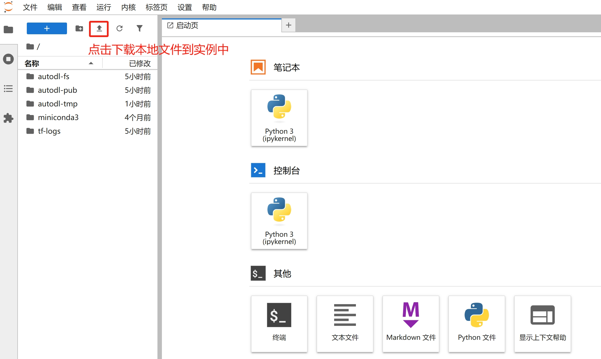
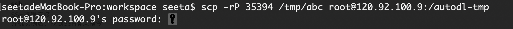

1. [公网网盘](/instance/data-storage/netdisk)，直接使用阿里云盘、夸克网盘、百度网盘、OSS上传下载数据，**强烈推荐**。
2. [JupyterLab](/instance/connection/jupyterlab)上传，和网盘类似，优点简单，但是只支持文件不支持文件夹。
3. scp命令支持文件和文件夹上传下载，由于是命令行执行，上手难度稍高。
4. [FileZilla](/best_practices/remote/filezilla)软件支持文件和文件夹，拖拉拽即可上传下载，**推荐使用**。
5. [XShell](/best_practices/remote/xshell)软件支持管理SSH连接，而且集成了xftp，支持拖拉拽上传下载文件夹/文件，**推荐使用**。
6. [AutoDL文件存储](/instance/data-storage/fs) 上传数据，优点简单而且不用开实例，缺点是网页不支持上传文件夹。

## 使用文件存储上传

参考 [文件存储](/instance/data-storage/fs) 小节。

## JupyterLab上传数据



## SCP远程拷贝

<Warning>
  注意下方指令需要在您**本地**的机器上执行，向实例中拷贝数据，而不是在实例中执行该命令;

  如果您是Windows用户，默认Windows系统未安装SSH客户端，推荐下载使用[Cmder](http://autodl-public.ks3-cn-beijing.ksyun.com/tool/cmder_mini.zip)工具，免安装解压即用。
</Warning>

复制您的ssh登录指令，指令格式为：`ssh -p 35394 root@region-1.autodl.com`   （注意35394为端口号，region-1.autodl.com为远程地址，请更换为您的实例端口和地址）

<Warning>
  ⚠️下面命令中参数是**`-rP`**，不是`-rp`
</Warning>

那么scp远程拷贝文件的指令为：`scp -rP 35394 <本地文件/文件夹>  root@region-1.autodl.com:/root/autodl-tmp`  （注意需要在您**本地**的机器上执行）



如果是将实例中的数据拷贝到本地，那么scp远程拷贝指令为：`scp -rP 35394  root@region-1.autodl.com:<实例中的文件/文件夹>  <本地文件/文件夹> `

### 高级使用方法

上面直接scp文件夹的方法，如果小文件多，那么scp速度会非常缓慢。可以使用以下方法拷贝tar流（前提需要本地电脑有tar命令）

```
cd <要拷贝的文件夹目录下>
tar cf - * | ssh -p 35394 root@region-1.autodl.com "cd /root/autodl-tmp && tar xf -"
```

## FileZilla

参考 [FileZilla](/best_practices/remote/filezilla)

## XShell

参考 [XShell](/best_practices/remote/xshell)
