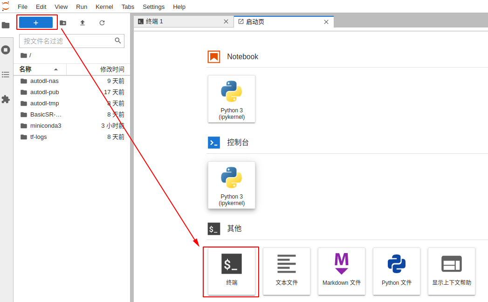
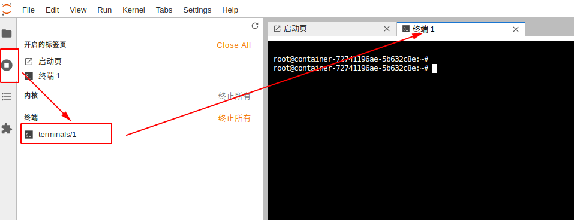
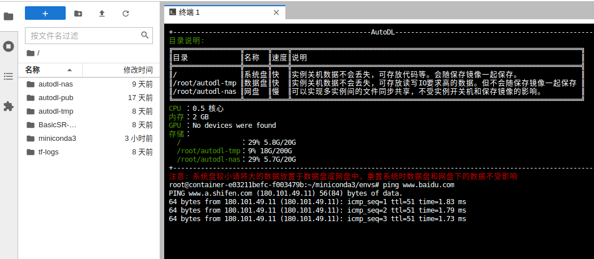
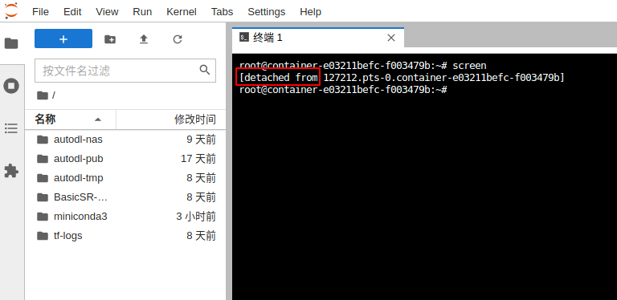
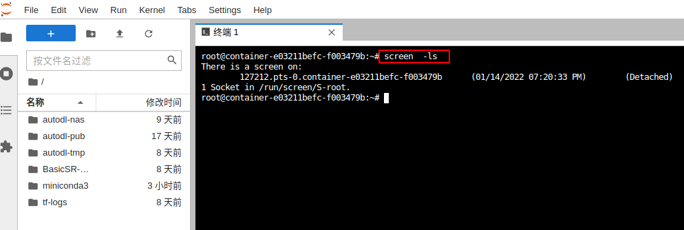
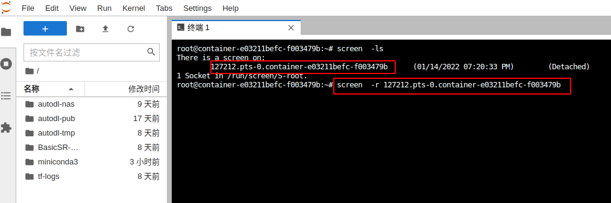
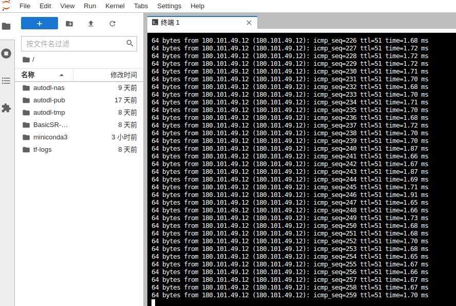

如果你通过ssh登录或以ssh为基础的工具软件（比如XShell、PyCharm，VSCode等，可以用这类工具调试，但是最终长时间运行时请以守护进程的方式执行命令）进行远程执行程序时，那么请注意开守护进程来执行程序，避免因为SSH连接中断导致程序终止，遭受不必要的损失。

通过守护进程执行你的程序有多种方式

1. `screen`，此外还有常用的`tmux`（如需安装执行：`apt-get update && apt-get install -y tmux`）工具，这里不做介绍
2. `jupyterlab`的终端
3. 如果你使用的是Notebook，Notebook断网后日志更新问题请参考[JupyterLab](/instance/connection/jupyterlab)文档最下方

## Jupyterlab

最简单的方式是通过jupyterlab的终端来执行，只要jupyterlab不出现重启（几乎不会），jupyterlab的终端就会一直运行，无论是本地主机断网还是关机。



如果你关闭了这个终端tab，可以在左侧栏中找回



打开时如果终端什么也不显示，按回车键即可。在使用JupyterLab长时间跑代码的过程中**强烈建议**对日志重定向，防止断网后中间的日志没有了。使用方法：

```
# 日志重定向到train.log文件。即在你的命令后加上：> train.log 2>&1
python xxx.py > train.log 2>&1
# 实时查看日志
tail -f train.log
```


## screen

安装screen在终端中执行：`apt-get update && apt-get install -y screen`

使用方法：

### 创建一个新的会话

终端中执行`screen`命令，然后在出来的界面按回车键，此时会出现一个和之前完全一样的终端（实际上是两个）。

此时在这个终端中执行的程序意味着会受到这个会话保护，比如在这里执行命令：



如果使用screen打开终端后中文乱码，执行以下命令后重新进入screen终端：

```
echo "defencoding GBK" >>  ~/.screenrc
echo "encoding UTF-8 GBK" >>  ~/.screenrc
```

### 离开会话

在用screen打开的终端中使用快捷键：`ctl + a + d`，会退出到原终端，并且显示detached，意味着这个会话只是离开并未退出。



### 重进入会话

先找到所有离开的会话：



然后恢复到对应的会话：



执行完以上命令，我们会发现最开始执行的`ping www.baidu.com`仍然在执行。因此就可以将我们的程序放在screen的会话中执行，然后离开会话，等我们需要看日志时再恢复到这个会话中。



### 退回会话

在用screen打开的终端中使用快捷键：`ctl + d`。如果有正在执行的程序，先`ctrl + c`终止程序

### screen乱码问题

加上`-U`参数即可，比如

```
新建：screen -U
恢复：screen -U -r xxx
```
