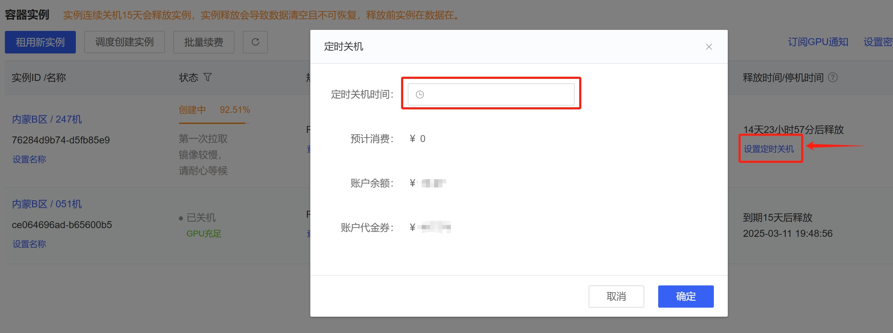
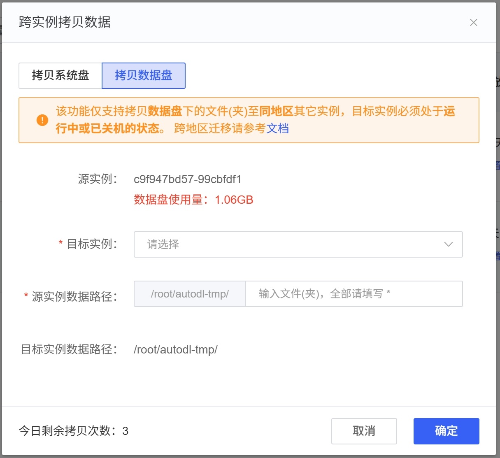

<Note>
  实例需要迁移的本地数据有**系统盘**和**数据盘**中的数据，两者均可迁移。
</Note>

需要迁移实例时，分两种情况：

1. 同地区迁移实例（**简单**、**快**）。可直接查看[迁移实例同地区版](/instance/migrate/migrate_instance_2)文档
2. 跨地区迁移实例。

<Tip>
  如果要消除空闲GPU不足迁移实例的烦恼，可以将按量计费转为包年包月（可以包日、周），方法为：在租用时选计费方式为包年包月，或已经租用的实例在实例的更多操作中点击「转包年包月」，查看[转换计费方式](/instance/configuration/change_billing_method)文档
</Tip>

## 迁移系统盘

无论是同地区还是跨地区迁移，迁移系统盘均推荐使用[**保存镜像**](/environment/image)功能。

保存镜像后，可在新地区选择[我的镜像]创建新实例。


<Tip>
  私有镜像在新地区第一次创建实例可能会比较耗时（镜像需要从公网传输到新地区，创建中状态不计费），如果担心创建完成后开机计费，有个小技巧：可以[设置定时关机]，关机时间设置在当前时间的3分钟后，比如当前是12:00,则设置12:03定时关机。这样当实例创建完成后会**自动触发关机**，以节省您的费用。下次实例开机或同地区创建即可获得较快的开机速度。
</Tip>



## 迁移实例数据盘：同地区

入口：实例的「更多操作」->「跨实例拷贝数据」->  「拷贝数据盘」。该功能拷贝数据的速度约100MB/s+，即使小文件也进行了优化具有非常高的速度。如果拷贝整个数据盘，则在「源实例数据路径」输入通配符`*`即可。

<Note>
假如将A实例数据迁移到B实例，则A为源实例，B为目标实例。
</Note>



## 迁移实例数据盘：跨地区

<Note>
  跨地区拷贝将走公网传输，速度较慢，一般为10MB/s左右。且小文件多时会慢数倍
</Note>

例如：将北京A区的源实例的某文件(夹)拷贝到内蒙A区的目标实例中

那么：

**Step.1** 内蒙A区的目标实例，假设其ssh指令为：ssh -p 66666 region-3.autodl.com

**Step.2** 在北京A区**源实例**的终端中执行

<Warning>
  下面命令中参数是`-rP`，不是`-rp`，其他的各项参数也应换为您ssh指令中的对应值
</Warning>

```
scp -rP 66666 /root/autodl-tmp/xxx root@region-3.autodl.com:/root/autodl-tmp/
```

也就是在北京A区的源实例上，将实例中的文件/文件夹（这里演示的是：/root/autodl-tmp/xxx）远程拷贝到内蒙A区的目标实例

**高级远程拷贝文件方法：**

上面直接scp文件夹的方法，如果小文件多，那么scp速度会非常缓慢。可以使用以下方法拷贝。

在北京A区的源实例终端中执行：

```
cd /root/autodl-tmp/ &&  tar cf - * | ssh -p 66666 root@region-3.autodl.com "cd /root/autodl-tmp && tar xf -"
```

以上命令可以将源实例中的/root/autodl-tmp目录下所有文件，拷贝到目标实例中

**借助网盘方法：**

可以先将源实例数据上传到网盘中，然后目标实例从网盘下载数据。网盘使用查看[公网网盘](/instance/data-storage/netdisk)文档

## 迁移实例：跨账号

1. 系统盘保存成私有镜像后分享给目标账号，参考[分享镜像](/environment/image)。
2. 数据盘参考上文中跨地区迁移实例数据盘方法。
