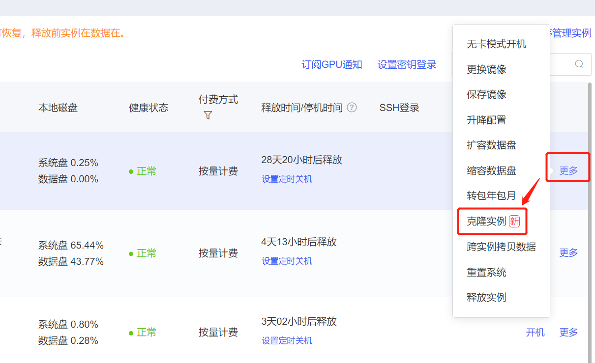
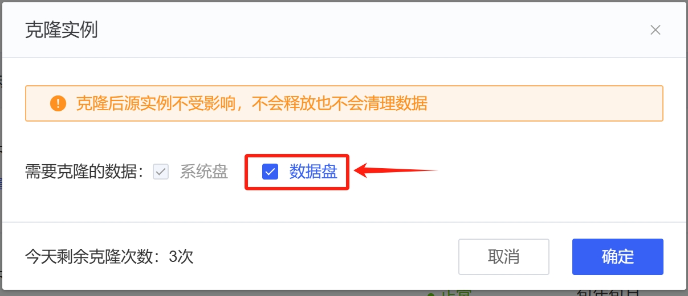
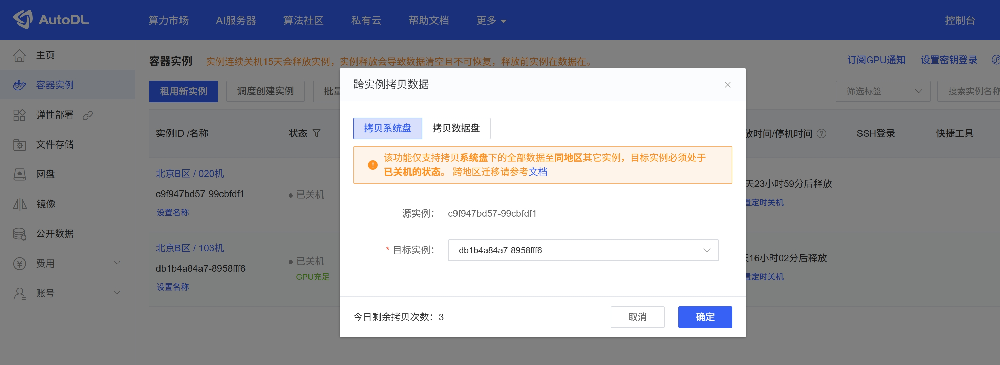

**同地区**迁移实例可以参考此文档，操作非常简单且迁移速度快。

<Note>
  1. 实例需要迁移的本地数据有**系统盘**和**数据盘**中的数据，两者均可迁移。
  2. 如果要消除空闲GPU不足迁移实例的烦恼，可以将按量计费转为包年包月（可以包日、周），方法为：在租用时选计费方式为包年包月，或已经租用的实例在实例的更多操作中点击「转包年包月」，查看[转换计费方式](/instance/configuration/change_billing_method)文档
</Note>

**Step0. 原实例关机**  
先关机原实例。

**Step1. 克隆实例**

克隆实例将以当前实例的**系统盘**为模板创建新实例，如果需要同时拷贝数据盘，那么请勾选数据盘选项，数据盘将在系统盘克隆完成后开始拷贝。

点击克隆实例后，在创建实例页面选择一台新主机创建实例即可。

<Tip>
如果您在克隆时忘了勾选同时拷贝数据盘，那么可以在新实例创建完成后，在原实例的更多操作中点击[跨实例拷贝数据](/instance/migrate/migrate_instance#迁移实例数据盘：同地区)，再对数据盘进行拷贝。
</Tip>

**Step2. 处理计费**  
如果您的原实例是包年包月的实例且新老实例配置相同，那么可以联系客服帮您转移订单到新实例（这种方式不会产生转换计费方式带来的时长损耗），如果自助处理则对原实例转按量计费即可。

**同地区已有实例，不想新创建一个实例**

1. 源实例系统盘[保存镜像](/environment/image)，目标实例更多操作里更换镜像。或者「更多操作」->「跨实例拷贝数据」->「拷贝系统盘」。注意确认源实例和目标实例，目标实例数据将被覆盖。
   
2. 数据盘参考[跨实例拷贝数据](/instance/migrate/migrate_instance)。
