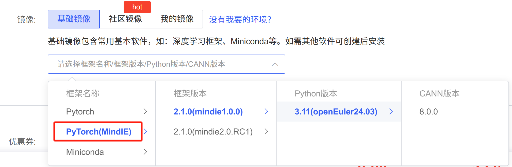

首先根据版本需求选择PyTorch MindIE镜像：

<Frame>
  
</Frame>

然后参考华为的文档：[推理服务部署（DeepSeek-R1-Distill-Qwen-7B）-AI服务部署-方案部署指南-RAG一体化解决方案参考实践-鲲鹏RAG开发文档-鲲鹏社区](https://www.hikunpeng.com/document/detail/zh/kunpengrag/bestpractice/kunpengrag_21_0012.html)

华为使用文档精简步骤：

1. 准备好模型

2. 编辑好`/usr/local/Ascend/mindie/latest/mindie-service/conf/config.json`文件，主要是修改模型的路径和Device Index等，这里还需要特别注意将config文件中的httpsEnabled字段设置为false，因为一般情况下没使用证书

3. 加载环境变量：
   
   ```bash
   source /usr/local/Ascend/ascend-toolkit/set_env.sh
   source /usr/local/Ascend/nnal/atb/set_env.sh
   source /usr/local/Ascend/atb-models/set_env.sh
   source /usr/local/Ascend/mindie/set_env.sh
   source /usr/local/Ascend/mindie/latest/mindie-service/set_env.sh
   ```

4. 启动服务
   
   ```bash
   cd /usr/local/Ascend/mindie/latest/mindie-service/bin
   ./mindieservice_daemon
   ```
