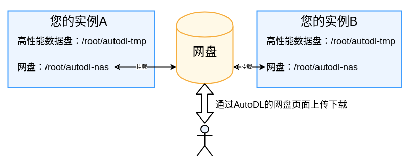
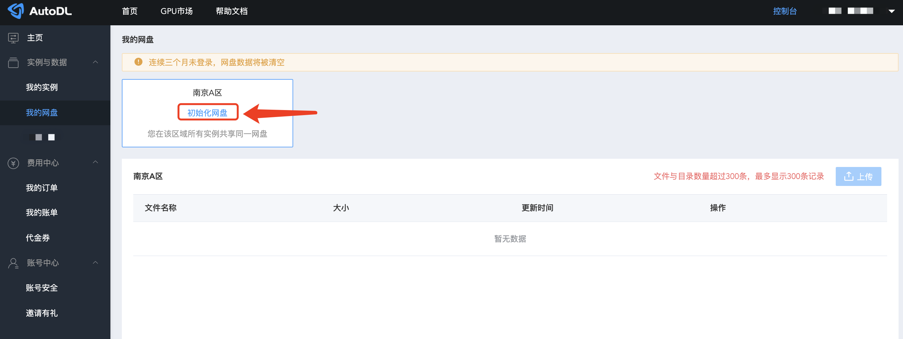
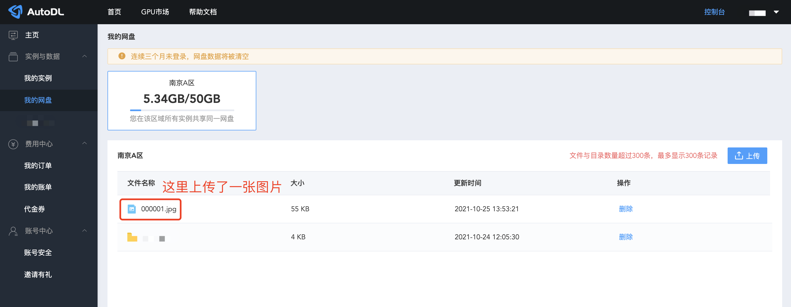
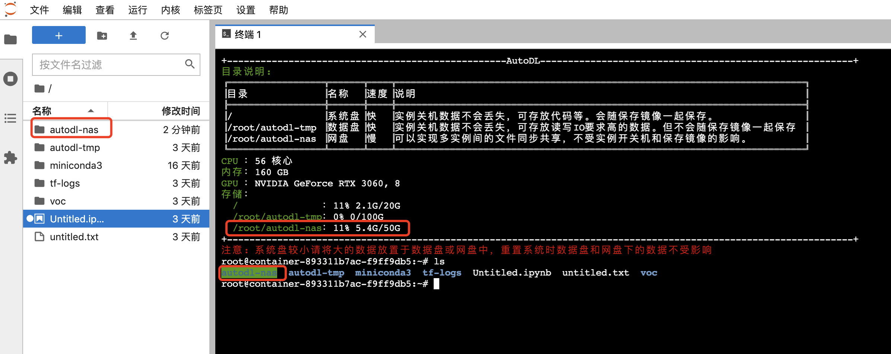
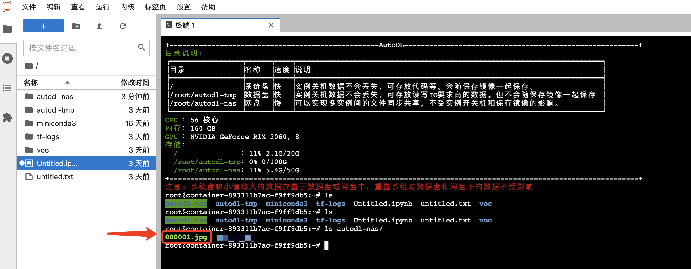
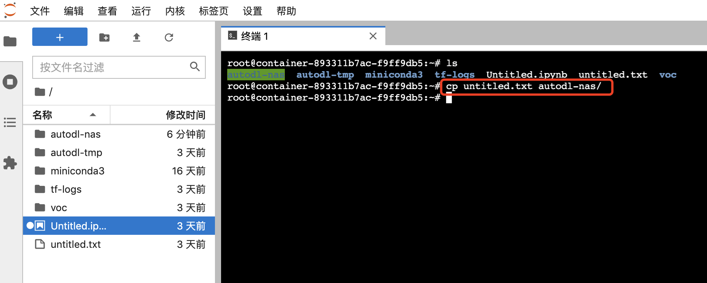
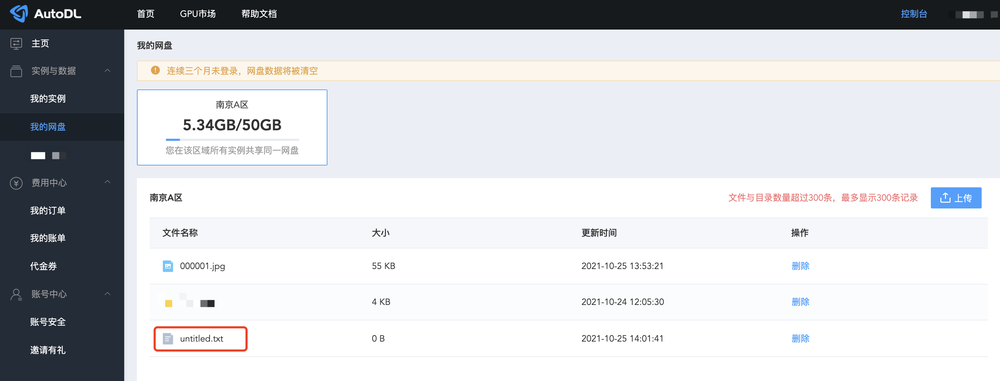

网盘可以将实例与实例之间的文件建立通道，并且您可以通过AutoDL网站提供的网盘文件上传入口，将文件上传到网盘中，或从网盘下载到本地。当上传文件到网盘后，所有挂载网盘的实例都能立即看到此文件。

不同地区的网盘是独立的，您在一个地区下的所有实例会使用同一个网盘进行实例间的文件共享。每个地区的网盘免费空间大小为：20GB。

<Frame>
  
</Frame>

## 网盘的使用

### 初始化网盘

首先确定在哪个地区下租用GPU主机，然后在&lt;我的网盘&gt;菜单下，初始化该地区的网盘。

<Frame>
  
</Frame>

### 上传文件

初始化后点击上传文件即可

<Frame>
  
</Frame>

### 在实例中使用网盘数据

在上个步骤上传了一张名为000001.jpg的图片，现在开机一个&lt;南京A区&gt;的实例，然后进入实例找到`autodl-nas`文件夹

<Frame>
  
</Frame>

执行 `ls autodl-nas`命令，可以看到我们在网页上传的000001.jpg图片

<Frame>
  
</Frame>

至此，我们可以把网盘中的数据当作特殊的文件夹进行使用。而且还可以将实例中的其他数据拷贝到网盘，给其他实例使用或在网页上查看，比如：

在实例中，把下方的untitled.txt文件拷贝到网盘目录中

<Frame>
  
</Frame>

然后在网页上查看网盘目录文件

<Frame>
  
</Frame>


## 不同区网盘数据同步

比如：需要将北京A区的某网盘数据同步到内蒙A区的网盘中

那么：

**Step.1** 在内蒙A区启动一个挂载网盘的实例，其ssh指令为：ssh -p 66666 region-3.autodl.com

**Step.1** 在北京A区启动一个挂载网盘的实例，然后在终端中执行

```
scp -rP 66666 /root/autodl-nas/xxxxx region-3.autodl.com:/root/autodl-nas/
```

也就是在北京A区的实例上，将网盘中的数据拷贝到远程内蒙A区的实例中（/root/autodl-nas目录就是内蒙A区的网盘）


### 注意事项

1. 网盘性能较数据盘差，因此想要获得更好的读数据性能，请先从网盘拷贝到autodl-tmp数据盘，再进行使用。
2. 从网页上传数据到网盘时无需实例开机。
3. 实例关机或释放后，网盘中的数据不受影响。


<br />
