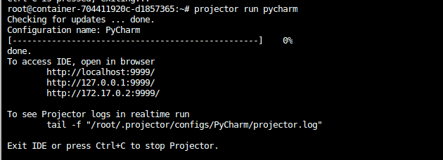
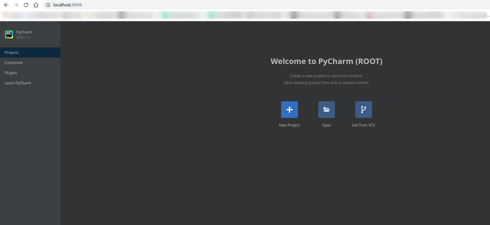

Projector是PyCharm远程开发的另一个选择，不需要PyCharm专业版，本地只需要一个浏览器即可（可以选装客户端连接），但是因为实际上是在传输图像流，对带宽要求高，比使用[PyCharm](/pycharm)和[VSCode](/vscode)做远程开发卡顿严重。

## 安装必要的依赖

在实例中执行：

```
apt-get update && apt install -y less libxext6 libxrender1 libxtst6 libfreetype6 libxi6
```

## 安装projector

在实例中执行：

```
pip3 install projector-installer
```

### 安装和运行PyCharm

在实例中执行：

```
 # 安装，第一次安装默认会运行
 projector install pycharm
 
 # 运行
 projector run pycharm
```

<Frame>
  
</Frame>


## 通过SSH代理实例9999端口

在您**本地电脑**上执行:  

 `ssh -CNg -L 9999:127.0.0.1:9999 root@region-1.autodl.com -p 43370`，将-p参数后`43370`端口改为您的实例SSH指令中的端口，`region-1.autodl.com`改为实例SSH指令中的地址。


## 本地浏览器打开PyCharm

访问：`http://localhost:9999/`

您还可以使用官方提供的Native App客户端来连接远程的Projector：`https://lp.jetbrains.com/projector/`

<Frame>
  
</Frame>
